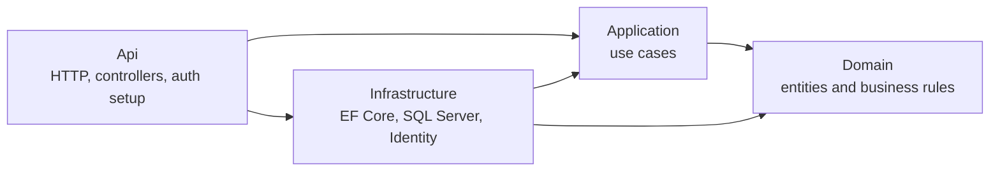
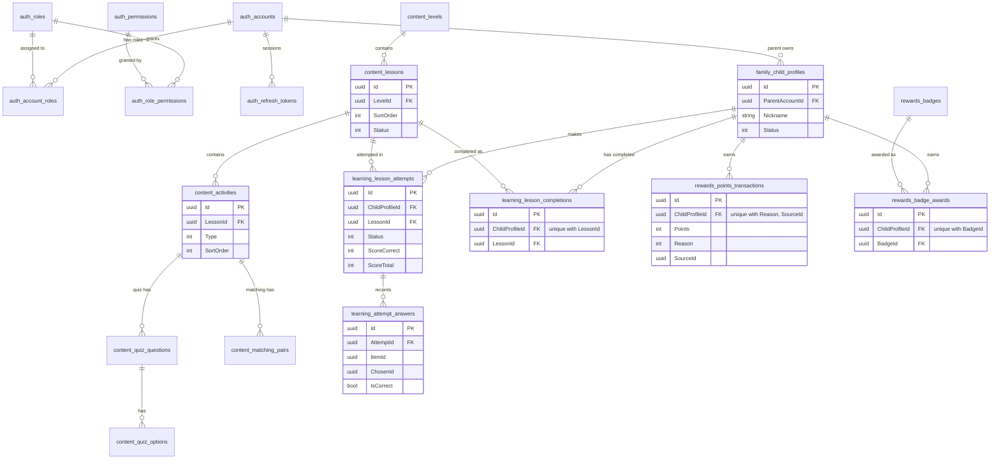

# Domain Model Proposal (MVP)

| | |
|---|---|
| **Status** | The **structure** (§3, §4 and §10) was approved in S0.4 on 2026-10-23 and recorded as ADR-1. The **entities, tables and flows** (§5 to §9) are still 💡 proposals, each approved in its own plan step. |
| **Last updated** | 2026-10-23 (rewritten for developer clarity) |
| **Based on** | [MVP Product Decisions](../../../docs/product/mvp-product-decisions.md) (PD-001 to PD-008, OQ-001 to OQ-016) |
| **Related** | [Implementation plan](../../../docs/roadmap/mvp-implementation-plan.md) · [decisions.md](decisions.md) · [overview.md](overview.md) |

Labels used in this document:

| Label | Meaning |
|---|---|
| ✅ **Exists** | In the repository today. I inspected the file. |
| 💡 **Proposed** | A suggestion. Nothing exists in code yet. |
| 🔁 **Recommended change** | Changes something that already exists, or an earlier version of this proposal. |
| ❓ **Undecided** | Depends on an open product question. Do not build it until that question is answered. |

Class names, file paths, table names and columns are suggestions. They become final only when a plan step is approved and its migration is reviewed.

---

## Contents

1. [What exists today](#1-what-exists-today)
2. [Words used in this document](#2-words-used-in-this-document)
3. [The whole solution: what goes in each layer](#3-the-whole-solution-what-goes-in-each-layer)
4. [The Domain project in detail](#4-the-domain-project-in-detail)
5. [Entity catalog](#5-entity-catalog)
6. [Things that are deliberately *not* Domain entities](#6-things-that-are-deliberately-not-domain-entities)
7. [Data model: diagram and table mapping](#7-data-model-diagram-and-table-mapping)
8. [Code flow example: a lesson is opened and a quiz answer is submitted](#8-code-flow-example)
9. [Authorization: roles, permissions and ownership](#9-authorization-roles-permissions-and-ownership)
10. [Module rules (ADR-1)](#10-module-rules-adr-1)
11. [Required rules and where they are enforced](#11-required-rules-and-where-they-are-enforced)
12. [Still undecided](#12-still-undecided)
13. [Change log](#13-change-log)

---

## 1. What exists today

✅ Inspected on 2026-10-23 (`BackEnd/src`, excluding migrations):

| Project | What is in it |
|---|---|
| `EnglishAdventure.Domain` | `Common/Entity.cs` (base class), `Enums/AccountType.cs` (enum Admin=1, Parent=2, Child=3; moved from `Users/` in S0.4) and `Exceptions/DomainException.cs`. **No business entities.** |
| `EnglishAdventure.Application` | `Authentication/` (login, logout, refresh, current user; interfaces `IIdentityUserService`, `IRefreshTokenService`, `IAccessTokenIssuer`, `IUserContext`), `Common/Behaviors/ValidationBehavior.cs`, `Common/Exceptions/*`, `Database/` (migrate command, `IDatabaseMigrator`), `Foundation/` (example query). |
| `EnglishAdventure.Infrastructure` | `Identity/` (`RefreshToken`, `IdentityUserService`, `IdentityPasswordHasher`, `RefreshTokenService`), `Authentication/` (JWT issuing), `Persistence/` (`EnglishAdventureDbContext`, `Configurations/Identity/*`, design-time factory, `DatabaseMigrator`, `Migrations/InitialCreate`). |
| `EnglishAdventure.Api` | `Controllers/` (`AuthController`, `DatabaseController`, `FoundationController`), `Contracts/Authentication/`, `Authentication/` (JWT bearer setup), `ExceptionHandling/`, `Filters/DevelopmentOnlyAttribute.cs`, `Program.cs`. |
| Database (migration `InitialCreate`, S0.5) | `auth_accounts`, `auth_roles`, `auth_permissions`, `auth_account_roles`, `auth_role_permissions`, `auth_refresh_tokens`. No ASP.NET `AspNet*` tables. |

Everything below this section is a proposal unless it is marked ✅.

---

## 2. Words used in this document

| Term | Plain meaning | English Adventure example |
|---|---|---|
| **Entity** | A business object with its own identity (an `Id`) that changes over time and keeps its own rules. | A `ChildProfile`. Renaming the child keeps the same `Id`, so it is still the same child. |
| **Aggregate root** | The "boss" entity of a small group. Code outside the group changes the group **only through the boss**, so the boss can protect the group's rules. The group is loaded and saved together. | `Lesson` is the boss of its activities, questions and options. You don't add a quiz option directly; you call `lesson.AddQuizOption(...)`, and the lesson refuses if it is already published. |
| **Child entity** | An entity that lives inside an aggregate and has no meaning on its own. | A `QuizOption` without its question is meaningless. |
| **Value object** | A small object defined only by its values: no `Id`, never changed after creation, it checks itself when created. | `Score(correct: 7, total: 10)`. Two scores of 7/10 are equal. A score of 11/10 cannot be created. |
| **Domain service** | A business rule that needs several entities and doesn't naturally belong to any one of them. A plain class with no database access. | `LessonUnlockPolicy` decides whether lesson 4 is open, based on the lesson order and which lessons the child completed. |
| **Repository** | An Application interface for loading and saving **one aggregate**, implemented with EF Core in Infrastructure. | `ILessonAttemptRepository.GetAsync(id)` loads an attempt together with its answers. |
| **Command / Query** (CQRS) | A command changes data; a query only reads it. Each is a small class with its own handler. | `SubmitActivityAnswersCommand` (changes) vs `GetChildProgressQuery` (reads). |
| **Handler** | The class that runs one command or query: it loads data, calls the entities, saves. | `SubmitActivityAnswersCommandHandler`. |
| **DTO** | A plain data shape for crossing a boundary (to the API, from a query). It has no rules. | `LessonForPlayDto`: a lesson with its questions, **without** the correct answers. |
| **Module** | A business area with its own folder in each project and its own table-name prefix (`content_`…). | Identity (exists), Family, Content, Learning, Rewards. |

### Why a database table doesn't always need a Domain entity (and the other way round)

A **table** stores data. An **entity** protects business rules. The two often match, but not always.

**Tables with no Domain entity:**
- `__EFMigrationsHistory` is owned by EF Core. No business rule lives there.
- `auth_refresh_tokens` *does* have a class (`RefreshToken`), but it is security machinery in Infrastructure, not a business entity. The reason is in §6.

**Business ideas with no table:**
- *"Is lesson 4 unlocked for Minh?"* is **calculated** from the lesson order and Minh's completions (`LessonUnlockPolicy`). Storing it would mean keeping a copy in sync whenever an Admin reorders lessons.
- *"How many points does Minh have?"* is the **sum** of the point transactions. Storing only a total would lose the history that PD-004 requires.

Creating an entity just because a table exists, or a table just because an idea exists, adds code that protects nothing.

---

## 3. The whole solution: what goes in each layer

Dependencies point **inward only**: Api → Application → Domain, and Infrastructure → Application → Domain. Domain references nothing. ✅ The project files already follow this.



### 3.1 Domain: "what the business is and what it forbids"

| Belongs here | Never here |
|---|---|
| Entities with behavior (`lesson.Publish()`), enums, value objects, domain services, `DomainException` | EF Core attributes or configuration, `DbContext`, SQL, ASP.NET Core, Identity types, HTTP, DTOs, logging, `DateTime.UtcNow` (time is passed in, so tests can control it) |

Folder tree: see §4.

### 3.2 Application: "what a user can do" (use cases)

| Belongs here | Never here |
|---|---|
| Commands, queries, handlers, validators, DTOs, repository and service **interfaces**, permission names, the ownership check (`ILearnerAccessGuard`), orchestration ("load, call the entity, save") | EF Core or SQL code (✅ current rule in CLAUDE.md), ASP.NET Core types, business rules that belong to an entity (for example "a published lesson cannot change" goes in `Lesson`, not in a handler) |

```text
EnglishAdventure.Application/
├── DependencyInjection.cs                       ✅ exists
├── Common/
│   ├── Behaviors/ValidationBehavior.cs          ✅ exists
│   ├── Exceptions/                              ✅ exists (NotFound, Unauthorized, …)
│   │   └── ConflictException.cs                 💡 for 409 (concurrent change)
│   ├── Authorization/Permissions.cs             💡 S1.1: permission name constants
│   └── Persistence/IUnitOfWork.cs               💡 SaveChangesAsync = one transaction
├── Authentication/                              ✅ exists (login, refresh, logout, me)
├── Database/                                    ✅ exists (Development migrate endpoint)
├── Foundation/                                  ✅ exists (example query)
├── Family/                                      💡
│   ├── IChildProfileRepository.cs
│   ├── ILearnerAccessGuard.cs                   "may the caller act for this child?"
│   ├── LearnerAccessGuard.cs
│   ├── Commands/CreateChildProfile/             Command, Handler, Validator
│   ├── Commands/ArchiveChildProfile/
│   └── Queries/GetMyChildren/
├── Content/                                     💡
│   ├── ILevelRepository.cs
│   ├── ILessonRepository.cs
│   ├── IContentQueries.cs                       read-only projections for learners and Admins
│   ├── Commands/CreateLesson/  PublishLesson/  AddQuizActivity/  AddMatchingActivity/ …
│   └── Queries/GetLessonMap/  GetLessonForPlay/
├── Learning/                                    💡
│   ├── ILessonAttemptRepository.cs
│   ├── ILessonCompletionRepository.cs
│   ├── Commands/StartLessonAttempt/
│   ├── Commands/SubmitActivityAnswers/          Command, Handler, Validator, Result
│   └── Queries/GetChildProgress/
└── Rewards/                                     💡
    ├── IRewardRepository.cs
    ├── IRewardGranter.cs                        called by Learning when a lesson is completed
    ├── RewardGranter.cs
    ├── Commands/CreateBadge/
    └── Queries/GetChildRewards/
```

**Why repositories?** The existing rule says Application must not use EF Core types. So Application needs small interfaces to load and save aggregates, and Infrastructure implements them with EF Core.
- There is **one repository per aggregate root**, with only the methods the use cases need.
- There is **no generic `IRepository<T>`**.
- Read-only screens use query interfaces (`IContentQueries`) that return DTOs directly. That is the "CQRS where it helps" part: reads skip the entities.

### 3.3 Infrastructure: "how data is stored and how external systems are used"

| Belongs here | Never here |
|---|---|
| `EnglishAdventureDbContext`, one EF configuration class per entity (table name, keys, indexes, lengths, row version), repository and query implementations, login/session services and password hashing, JWT issuing, migrations | Business rules (a configuration may add a unique index as a **safety net**, but the rule itself lives in the entity), HTTP concerns |

```text
EnglishAdventure.Infrastructure/
├── DependencyInjection.cs                       ✅ exists (registers DbContext, login services, tokens)
├── Authentication/                              ✅ exists (JwtAccessTokenIssuer, JwtOptions)
├── Identity/                                    ✅ exists: login and session machinery, NOT business entities
│   ├── IdentityUserService.cs                   login checks over the Account entity
│   ├── IdentityPasswordHasher.cs                IPasswordHasher via Microsoft's PBKDF2 hasher
│   └── RefreshToken.cs  RefreshTokenService.cs  RefreshTokenHasher.cs
└── Persistence/
    ├── EnglishAdventureDbContext.cs             ✅ exists (plain DbContext). 💡 add DbSets per module, implement IUnitOfWork
    ├── EnglishAdventureDbContextFactory.cs      ✅ exists
    ├── DatabaseMigrator.cs                      ✅ exists
    ├── Migrations/                              ✅ exists (InitialCreate)
    ├── Configurations/                          one file per entity
    │   ├── Identity/                            ✅ Account, AccountRole, Role, RolePermission, Permission, RefreshToken
    │   ├── Family/ChildProfileConfiguration.cs  💡
    │   ├── Content/LevelConfiguration.cs  LessonConfiguration.cs  LearningActivityConfiguration.cs
    │   │          QuizQuestionConfiguration.cs  QuizOptionConfiguration.cs  MatchingPairConfiguration.cs
    │   ├── Learning/LessonAttemptConfiguration.cs  AttemptAnswerConfiguration.cs  LessonCompletionConfiguration.cs
    │   └── Rewards/PointsTransactionConfiguration.cs  BadgeConfiguration.cs  BadgeAwardConfiguration.cs
    ├── Repositories/                            💡 Family/ Content/ Learning/ Rewards/
    └── Queries/                                 💡 ContentQueries.cs, ProgressQueries.cs (read-only, DTOs)
```

✅ `ApplyConfigurationsFromAssembly` in the existing `DbContext` already picks up every configuration class automatically.

### 3.4 Api: "HTTP in, HTTP out"

| Belongs here | Never here |
|---|---|
| Controllers (thin: map HTTP to `IMediator.Send`), request/response contracts, authentication and authorization setup, exception-to-HTTP mapping, DI composition (`Program.cs`) | Business rules, EF Core queries, ownership logic |

```text
EnglishAdventure.Api/
├── Program.cs  DependencyInjection.cs           ✅ exist
├── Authentication/                              ✅ exists (JWT bearer setup, IUserContext implementation)
├── Authorization/PermissionPolicyProvider.cs    💡 S1.1: turns "content.manage" into a policy
├── Contracts/Authentication/                    ✅ exists
├── Contracts/Learning/SubmitActivityAnswersRequest.cs   💡
├── Controllers/                                 ✅ Auth, Database, Foundation
│   ├── ChildProfilesController.cs               💡 Parent
│   ├── ContentAdminController.cs                💡 ContentAdmin / SuperAdmin
│   ├── LearningController.cs                    💡 learning flow
│   └── RewardsController.cs                     💡
├── ExceptionHandling/GlobalExceptionHandler.cs  ✅ exists. 💡 add ConflictException → 409
└── Filters/DevelopmentOnlyAttribute.cs          ✅ exists
```

### 3.5 Tests

```text
tests/EnglishAdventure.Domain.UnitTests/Entities/Content/LessonTests.cs        💡 pure rules, no database
tests/EnglishAdventure.Domain.UnitTests/Services/LessonUnlockPolicyTests.cs   💡
tests/EnglishAdventure.Application.UnitTests/Learning/SubmitActivityAnswersCommandHandlerTests.cs  💡 fakes, no mocks library
tests/EnglishAdventure.Api.IntegrationTests/Learning/CrossFamilyAccessTests.cs  💡 real SQL, throwaway database
```

---

## 4. The Domain project in detail

```text
EnglishAdventure.Domain/
├── Common/
│   └── Entity.cs                    ✅ base class: Guid Id + equality by Id. Nothing else.
├── Entities/
│   ├── Identity/                    ✅ exists (S0.5)
│   │   ├── Account.cs               aggregate root (sign-in account, lockout, roles)
│   │   ├── AccountRole.cs           child entity
│   │   ├── Role.cs                  aggregate root (bundle of permissions)
│   │   ├── RolePermission.cs        child entity
│   │   └── Permission.cs            aggregate root (one authorizable action)
│   ├── Family/
│   │   └── ChildProfile.cs          aggregate root
│   ├── Content/
│   │   ├── Level.cs                 aggregate root
│   │   ├── Lesson.cs                aggregate root (owns everything below)
│   │   ├── LearningActivity.cs      child entity (abstract base)
│   │   ├── QuizActivity.cs          child entity
│   │   ├── QuizQuestion.cs          child entity
│   │   ├── QuizOption.cs            child entity
│   │   ├── MatchingActivity.cs      child entity
│   │   └── MatchingPair.cs          child entity
│   ├── Learning/
│   │   ├── LessonAttempt.cs         aggregate root
│   │   ├── AttemptAnswer.cs         child entity
│   │   └── LessonCompletion.cs      aggregate root
│   └── Rewards/
│       ├── PointsTransaction.cs     aggregate root (one entry in the points history)
│       ├── Badge.cs                 aggregate root (badge definition)
│       └── BadgeAward.cs            aggregate root (a badge a child earned)
├── Enums/
│   ├── AccountType.cs               ✅ exists (moved from Users/ in S0.4)
│   ├── ChildProfileStatus.cs        Active, Archived
│   ├── ContentStatus.cs             Draft, Published, Archived (levels and lessons)
│   ├── ActivityType.cs              Quiz, Matching
│   ├── AttemptStatus.cs             InProgress, Finished, Abandoned
│   ├── PointsReason.cs              LessonCompleted (more when OQ-004 is answered)
│   └── BadgeCriteriaType.cs         LessonsCompleted, PerfectScore, LevelCompleted (❓ OQ-004)
├── ValueObjects/
│   ├── Nickname.cs                  1–50 characters, trimmed, not blank
│   ├── Score.cs                     Correct, Total, Percent; Correct ≤ Total
│   ├── SubmittedAnswer.cs           ItemId + ChosenId (what the learner picked)
│   ├── ActivityGrade.cs             per-item results of grading one activity
│   └── BadgeCriteria.cs             Type + Threshold
├── Services/                        💡 added to your starting structure (see below)
│   ├── LessonUnlockPolicy.cs
│   └── BadgeEvaluator.cs
└── Exceptions/
    └── DomainException.cs           ✅ exists
```

**Folder by folder:**

- **`Common/`** holds one base class, `Entity`, so every entity has `Guid Id` and is compared by `Id`. There is deliberately no `AggregateRoot` base class or marker interface: the code would be empty, and this document records which entities are roots.
- **`Entities/<Module>/`** holds the business entities, grouped by module. Namespaces follow the folders: `EnglishAdventure.Domain.Entities.Content`, and so on.
- **`Enums/`** holds fixed lists of values. They are shared in one folder because there are only a few.
- **`ValueObjects/`** holds small self-checking values. Each one removes repeated checks from entities. For example, every place that needs a score uses `Score`, and no code ever has to check `correct <= total` again.
- **`Services/`** (🔁 added to your starting structure) holds the two rules that need several entities at once:
  - **Unlocking** needs the ordered lessons and the child's completions.
  - **Badge evaluation** needs badge definitions and the child's history.

  They are plain classes with no database access, so they are easy to unit-test.
- **`Exceptions/`** holds `DomainException`, thrown when a business rule is broken. The API turns it into HTTP 422 (✅ `GlobalExceptionHandler` already does this).

**How entities stay free of EF Core:**
- Properties have `private set`, and changes happen through methods.
- Collections are private `List<T>` fields exposed as `IReadOnlyCollection<T>`.
- Each entity has a private parameterless constructor for EF. That is the only concession to EF.
- Concurrency tokens (`RowVersion`) are **shadow properties** configured in Infrastructure, so they never appear in Domain classes.

✅ **Done in S0.4:** `AccountType` moved from `Domain/Users/` to `Domain/Enums/` (namespace `EnglishAdventure.Domain.Enums`). The database is unaffected. `Entities/Identity/` holds the five Identity entities. `Entities/{Family,Content,Learning,Rewards}/` stay empty until their plan step is approved (git does not track empty folders). `ValueObjects/` and `Services/` hold a `README.md` listing what will go there.

**What an entity looks like (sketch, not final code):**

```csharp
namespace EnglishAdventure.Domain.Entities.Family;

public sealed class ChildProfile : Entity
{
    private ChildProfile() { }                       // for EF Core only

    public Guid ParentAccountId { get; private set; } // the Parent's account (auth_accounts.Id); no navigation property
    public Nickname Nickname { get; private set; } = null!;
    public string? AvatarKey { get; private set; }
    public ChildProfileStatus Status { get; private set; }
    public DateTime CreatedAtUtc { get; private set; }

    public static ChildProfile Create(Guid parentAccountId, Nickname nickname, string? avatarKey, DateTime nowUtc)
        => new() { Id = Guid.NewGuid(), ParentAccountId = parentAccountId, Nickname = nickname,
                   AvatarKey = avatarKey, Status = ChildProfileStatus.Active, CreatedAtUtc = nowUtc };

    public bool IsOwnedBy(Guid accountId) => ParentAccountId == accountId;

    public void Rename(Nickname nickname) { EnsureActive(); Nickname = nickname; }

    public void Archive() => Status = ChildProfileStatus.Archived;

    public void EnsureCanLearn() => EnsureActive();

    private void EnsureActive()
    {
        if (Status != ChildProfileStatus.Active)
            throw new DomainException("This child profile is archived.");
    }
}
```

---

## 5. Entity catalog

### 5.0 Identity module (tables `auth_*`): ✅ built in S0.5

These replace the ASP.NET Core Identity tables (ADR-5). They are real entities with their rules inside them.

| Entity | Kind | Table | Purpose | Main rules |
|---|---|---|---|---|
| `Account` | aggregate root | `auth_accounts` | A sign-in account: email, password **hash**, account type, active flag, lockout state | Valid email; unique `NormalizedEmail` (unique index); the 5th wrong password locks it for 15 minutes; an inactive account cannot sign in |
| `AccountRole` | child of `Account` | `auth_account_roles` | One role given to an account, with when and by whom | One per account and role (unique index); a role still in use cannot be deleted |
| `Role` | aggregate root | `auth_roles` | A named bundle of permissions (SuperAdmin, ContentAdmin, Parent) | Name 1–64 characters, unique |
| `RolePermission` | child of `Role` | `auth_role_permissions` | One permission granted to a role | One per role and permission (unique index) |
| `Permission` | aggregate root | `auth_permissions` | One authorizable action, for example `content.manage` | Code like `<area>.<action>` in lower case, unique |

`RefreshToken` (table `auth_refresh_tokens`) stays in Infrastructure: it is session security machinery with special SQL for rotation, not a business concept.

**Key convention (🔁 changed from the previous proposal):** every entity has a single `Guid Id` primary key. Business uniqueness, such as "one completion per child and lesson", is a **unique index**. One key style everywhere is easier to read and to map in EF. The database protection is exactly the same.

### 5.1 Family module (tables `family_*`)

#### ChildProfile: aggregate root ❓ partly depends on OQ-001, OQ-009, OQ-013
- **Purpose:** the child as a **learner**. It is the stable identity that owns all progress, attempts, points and badges (PD-001). It is **not** a login account. Whether children ever get login credentials is undecided (PD-007 / OQ-001 / OQ-009).
- **Table:** `family_child_profiles` · **PK:** `Id`
- **Properties:** `ParentAccountId`, `Nickname` (value object), `AvatarKey?` (chosen from a fixed set, no photos), `Status`, `CreatedAtUtc`
- **Relationships:**
  - Belongs to one Parent account: `ParentAccountId` → `auth_accounts.Id`, a database foreign key with no C# navigation property.
  - Referenced by attempts, completions, points and badge awards.
- **Rules:**
  - The nickname is valid (1–50 characters, trimmed).
  - Only an active profile can be renamed or start learning.
  - Ownership test: `IsOwnedBy(accountId)`.
- **The parent–child relationship:**
  - Today it is just the `ParentAccountId` column. One owning Parent per child.
  - ❓ If OQ-013 allows two guardians, this becomes a child entity `ChildProfileGuardian (ChildProfileId, AccountId)` in table `family_child_profile_guardians`, and `IsOwnedBy` checks that list instead.
- **No real name, birth date or email** is stored (privacy principles), unless a later decision requires it.

### 5.2 Content module (tables `content_*`)

#### Level: aggregate root
- **Purpose:** a stage of the adventure that groups lessons, for example "Level 1: Animals".
- **Table:** `content_levels` · **PK:** `Id`
- **Properties:** `Title`, `Description?`, `SortOrder`, `Status` (`ContentStatus`)
- **Relationships:** has many lessons. Lessons point to the level by `LevelId`; there is no collection on `Level`, because lessons are their own aggregates.
- **Rules:**
  - The title is required.
  - `SortOrder` is unique among levels.
  - Status changes follow Draft → Published → Archived (unpublishing returns it to Draft).
  - Learners see a level only when it is published **and** has at least one published lesson. That second check is done by the query, because it needs the lessons.
- **Why not one big aggregate with all its lessons?** Editing one quiz option would then load the whole level. Keeping `Lesson` separate keeps every save small.

#### Lesson: aggregate root (owns activities, questions, options and pairs)
- **Purpose:** one playable unit: an ordered list of activities. It is also the unit that is completed and unlocked (PD-002).
- **Table:** `content_lessons` · **PK:** `Id`
- **Properties:** `LevelId`, `Title`, `SortOrder`, `Status`, `PublishedAtUtc?`, `Activities` (read-only list)
- **Relationships:** belongs to one `Level` (foreign key). Owns its `LearningActivity` entries.
- **Behavior:**
  - `AddQuizActivity`, `AddMatchingActivity`, `RemoveActivity`, `ReorderActivities`, `Rename`
  - `Publish(nowUtc)`, `Unpublish()`, `Archive()`
  - `GetActivity(activityId)`
- **Rules:**
  - Unique `SortOrder` within a level.
  - Can be published only with at least 1 activity and every activity valid.
  - ❓ **OQ-005, proposed:** while published, the structure is locked. No adding or removing activities, questions, options or pairs, and no changing correct answers. Fixing typos is allowed. Bigger changes mean unpublishing or creating a new lesson. This keeps old attempts valid without content versioning.

#### LearningActivity: child entity (abstract), with `QuizActivity` and `MatchingActivity`
- **Purpose:** one game inside a lesson (PD-003). There are two kinds, so they share a small base class instead of a "generic game engine".
- **Table:** `content_activities`. One table for both kinds, with a `Type` column as the discriminator (EF "table per hierarchy"). · **PK:** `Id`
- **Properties (base):** `LessonId`, `SortOrder`, `Type`, `Instructions?`
- **Behavior:** `Validate()` (is it ready to publish?) and `Grade(IReadOnlyList<SubmittedAnswer>) → ActivityGrade`.
- **Rules:** unique `SortOrder` within the lesson.
- **`QuizActivity`:**
  - Owns `QuizQuestion` entries. Valid with at least 1 question, each of them valid.
  - Grading: a question is correct when the chosen option is the correct option.
- **`MatchingActivity`:**
  - Owns `MatchingPair` entries. Valid with at least 2 pairs and no left or right value appearing twice.
  - Grading: each left item is correct when it is matched to its own pair.

#### QuizQuestion: child entity
- **Purpose:** one question in a quiz, for example "Which one is a cat?"
- **Table:** `content_quiz_questions` · **PK:** `Id` · **FK:** `ActivityId`
- **Properties:** `SortOrder`, `Prompt`, `ImageUrl?` (❓ OQ-011: URL or upload), `Options`
- **Rules:** at least 2 options and exactly 1 correct option (❓ OQ-015).

#### QuizOption: child entity
- **Purpose:** one answer choice.
- **Table:** `content_quiz_options` · **PK:** `Id` · **FK:** `QuestionId`
- **Properties:** `SortOrder`, `Text`, `IsCorrect`
- **Rules:** the text is required. `IsCorrect` is **never** sent to learners: the play DTO leaves it out.

#### MatchingPair: child entity
- **Purpose:** one correct pairing, for example "dog" ↔ 🐶 picture.
- **Table:** `content_matching_pairs` · **PK:** `Id` · **FK:** `ActivityId`
- **Properties:** `SortOrder`, `LeftText`, `RightText?`, `RightImageUrl?`
- **Rules:** exactly one of `RightText` and `RightImageUrl` is set.

### 5.3 Learning module (tables `learning_*`)

> 💡 The product decisions list "Games & Assessment" and "Learning Progress" separately. They are **one module** here because grading, finishing an attempt, recording completion and unlocking are one consistent action.

#### LessonAttempt: aggregate root (owns `AttemptAnswer`)
- **Purpose:** one try at a lesson by one child: what they answered, and the result.
- **Table:** `learning_lesson_attempts` · **PK:** `Id`
- **Properties:** `ChildProfileId`, `LessonId`, `Status` (`AttemptStatus`), `StartedAtUtc`, `FinishedAtUtc?`, `Score?` (value object, stored as two columns), `Passed?`, `Answers`
- **Relationships:**
  - References `ChildProfile` and `Lesson` by ID. These are database foreign keys with no navigation properties, because they belong to other modules.
  - Owns `AttemptAnswer` entries.
- **Behavior:**
  - `Start(childProfileId, lesson, nowUtc)`
  - `SubmitActivity(lesson, activityId, answers, nowUtc) → ActivityGrade`
  - `Abandon()`
- **Rules:**
  - Answers are accepted only while the attempt is `InProgress`.
  - The activity must belong to this attempt's lesson.
  - **Each activity is graded only once.** Submitting the same activity again returns the stored result and changes nothing, so retries are safe.
  - Grading always happens on the server, from the lesson's answer key; any score sent by the client is ignored.
  - When the last activity is answered, the attempt finishes itself: `Score` = correct items ÷ all items, and `Passed` = whether it meets the completion rule (❓ OQ-002).
- **Granularity (💡, ties to ❓ OQ-012):** answers are submitted **per activity**. The child gets feedback after each game, and an unfinished attempt keeps the activities already answered. Whether a child can come back later and *continue* that attempt is OQ-012.

#### AttemptAnswer: child entity
- **Purpose:** one graded answer, for example "for question Q1 the child chose option O3, which is wrong". It is the history that lets Parents see results and explains the score.
- **Table:** `learning_attempt_answers` · **PK:** `Id` · **FK:** `AttemptId`
- **Properties:** `ActivityId`, `ItemId`, `ChosenId`, `IsCorrect`, `AnsweredAtUtc`
- **What the IDs mean:**
  - Quiz: `ItemId` is a `QuizQuestion.Id` and `ChosenId` is a `QuizOption.Id`.
  - Matching: `ItemId` is the left `MatchingPair.Id` and `ChosenId` is the pair whose right side the child picked.
- **Rules:** unique (`AttemptId`, `ItemId`): one answer per item per attempt.

#### LessonCompletion: aggregate root
- **Purpose:** the fact that a child **has completed** a lesson. It drives unlocking (PD-002) and is the single record that triggers completion rewards.
- **Table:** `learning_lesson_completions` · **PK:** `Id`
- **Properties:** `ChildProfileId`, `LessonId`, `FirstCompletedAtUtc`, `FirstAttemptId`, `BestScorePercent`
- **Rules:**
  - **Unique index on (`ChildProfileId`, `LessonId`)**, so a lesson can be completed only once.
  - `RecordBetterScore(score)` only ever raises the best score (❓ OQ-003: replay rules).
- **Why not just look at attempts?** Completion *could* be calculated from attempts. But a separate row gives the database a hard guard against double completion (and therefore double rewards), and makes unlock checks a cheap lookup.

#### Lesson unlocking: no entity and no table (domain service `LessonUnlockPolicy`)
- **Input:** the ordered list of published lesson IDs (by level order, then lesson order) and the child's completed lesson IDs.
- **Rule (💡):**
  - The first lesson is open.
  - Each lesson after it opens when the lesson before it is completed.
  - A lesson the child already completed **stays open**, so an Admin reordering lessons never takes progress away.
  - ❓ OQ-016 may change "the lesson before it" to "every lesson of the previous level".

### 5.4 Rewards module (tables `rewards_*`)

#### PointsTransaction: aggregate root
- **Purpose:** one entry in a child's points history, for example "+10 for completing lesson 3". The total is the sum, and every point can be explained (PD-004).
- **Table:** `rewards_points_transactions` (🔁 renamed from `PointsLedger`: one row is one transaction) · **PK:** `Id`
- **Properties:** `ChildProfileId`, `Points`, `Reason` (`PointsReason`), `SourceId` (for example the lesson ID), `CreatedAtUtc`
- **Rules:**
  - Points are greater than zero.
  - Rows are never edited.
  - **Unique index on (`ChildProfileId`, `Reason`, `SourceId`)**, so the same reason can't pay twice.
  - ❓ How many points per reason is OQ-004.

#### Badge: aggregate root (definition)
- **Purpose:** a badge that can be earned, for example "Bookworm: complete 5 lessons".
- **Table:** `rewards_badges` · **PK:** `Id`
- **Properties:** `Code` (unique, stable), `Name`, `Description`, `IconUrl?`, `Criteria` (value object `BadgeCriteria`: type + threshold), `IsActive`
- **Rules:**
  - The criteria come from a fixed list implemented in code (❓ OQ-004).
  - The threshold is valid for its type.
  - Managed by holders of `rewards.manage` (§9).

#### BadgeAward: aggregate root
- **Purpose:** a badge a specific child has earned, and when.
- **Table:** `rewards_badge_awards` · **PK:** `Id`
- **Properties:** `ChildProfileId`, `BadgeId`, `AwardedAtUtc`, `SourceAttemptId?`
- **Rules:** **unique index on (`ChildProfileId`, `BadgeId`)**, so each badge is earned only once.
- **Badge evaluation** (domain service `BadgeEvaluator`) decides which active badges a child has newly earned, from simple facts such as "completed lessons = 5" or "this score was perfect".

---

## 6. Keeping the concepts apart

Since S0.5, accounts, roles and permissions are our own entities in the Identity module, no longer ASP.NET framework classes. They are still kept **separate from the learning domain**:

| Concept | Where it lives | Notes |
|---|---|---|
| **Account** (login identity) | ✅ `Domain/Entities/Identity/Account.cs` → `auth_accounts` | Email, password hash, lockout. Other modules refer to an account only by its `Guid` (for example `ParentAccountId`). It is never copied into a "Parent" or "User" entity. |
| **Account type** (Admin, Parent, Child) | ✅ `Domain/Enums/AccountType.cs`, stored on `auth_accounts` | It describes who the user is in the product. It **grants nothing**. |
| **Role** | ✅ `Domain/Entities/Identity/Role.cs` → `auth_roles`; assignments in `auth_account_roles` | A role is only a named bundle of permissions. The three roles are decided in PD-008. |
| **Permission** | ✅ `Domain/Entities/Identity/Permission.cs` → `auth_permissions`; grants in `auth_role_permissions`. 💡 Names as constants in `Application/Common/Authorization/Permissions.cs` (S1.1) | The catalog is defined in code and synced into these tables (S1.2). |
| **Parent–child relationship** | `ChildProfile.ParentAccountId` (§5.1) | It is a property of the child profile, not a separate entity, unless OQ-013 needs more than one guardian. |
| **Child learning profile** | `Domain/Entities/Family/ChildProfile.cs` | The learner. It is **not** an account. |
| **Refresh token / session** | ✅ `Infrastructure/Identity/RefreshToken.cs` → `auth_refresh_tokens` | Security machinery, not business, so it is not a Domain entity. |
| **"Parent" entity** | None | A Parent is an account plus the Parent role. If parent-specific business data appears later (for example a consent record for OQ-008), a `ParentProfile` entity can be added then. |

---

## 7. Data model: diagram and table mapping

### 7.1 Diagram

The identity tables (in `dbo`) exist today (S0.5). Everything else is proposed. Only the key columns are shown; the full columns are in §5.



### 7.2 Mapping table

| Entity | Database schema | Table | Primary key | Relationships |
|---|---|---|---|---|
| `Account` ✅ | `dbo` | `auth_accounts` | `Id` | owns `auth_account_roles`; has refresh tokens; owns child profiles (by `ParentAccountId`); unique `NormalizedEmail` |
| `AccountRole` ✅ | `dbo` | `auth_account_roles` | `Id` | → `auth_accounts` (cascade), → `auth_roles` (restrict), → `auth_accounts` via `AssignedByAccountId`; unique (`AccountId`, `RoleId`) |
| `Role` ✅ | `dbo` | `auth_roles` | `Id` | owns `auth_role_permissions`; unique `Name` |
| `RolePermission` ✅ | `dbo` | `auth_role_permissions` | `Id` | → `auth_roles` (cascade), → `auth_permissions` (restrict); unique (`RoleId`, `PermissionId`) |
| `Permission` ✅ | `dbo` | `auth_permissions` | `Id` | ← `auth_role_permissions`; unique `Code` |
| *(Infrastructure)* `RefreshToken` ✅ | `dbo` | `auth_refresh_tokens` | `Id` | → `auth_accounts` (cascade); unique `TokenHash` |
| `ChildProfile` | `dbo` | `family_child_profiles` | `Id` | → `auth_accounts` via `ParentAccountId` (no cascade) |
| `Level` | `dbo` | `content_levels` | `Id` | ← `content_lessons` |
| `Lesson` | `dbo` | `content_lessons` | `Id` | → `content_levels`; owns `content_activities` (cascade) |
| `QuizActivity`, `MatchingActivity` | `dbo` | `content_activities` (one table, `Type` column) | `Id` | → `content_lessons`; owns questions or pairs (cascade) |
| `QuizQuestion` | `dbo` | `content_quiz_questions` | `Id` | → `content_activities`; owns `content_quiz_options` (cascade) |
| `QuizOption` | `dbo` | `content_quiz_options` | `Id` | → `content_quiz_questions` |
| `MatchingPair` | `dbo` | `content_matching_pairs` | `Id` | → `content_activities` |
| `LessonAttempt` | `dbo` | `learning_lesson_attempts` | `Id` | → `family_child_profiles`, → `content_lessons` (no cascade); owns `learning_attempt_answers` (cascade) |
| `AttemptAnswer` | `dbo` | `learning_attempt_answers` | `Id` | → `learning_lesson_attempts`; unique (`AttemptId`, `ItemId`) |
| `LessonCompletion` | `dbo` | `learning_lesson_completions` | `Id` | → `family_child_profiles`, → `content_lessons`, → `learning_lesson_attempts` (first); unique (`ChildProfileId`, `LessonId`) |
| `PointsTransaction` | `dbo` | `rewards_points_transactions` | `Id` | → `family_child_profiles`; unique (`ChildProfileId`, `Reason`, `SourceId`) |
| `Badge` | `dbo` | `rewards_badges` | `Id` | ← `rewards_badge_awards`; unique `Code` |
| `BadgeAward` | `dbo` | `rewards_badge_awards` | `Id` | → `family_child_profiles`, → `rewards_badges`; unique (`ChildProfileId`, `BadgeId`) |

**Cascade rule:**
- Deleting an aggregate root deletes the things it owns: a lesson deletes its activities, an attempt deletes its answers.
- Links **between modules never cascade**. Deleting a lesson must not silently erase a child's history.
- How a child's data is deleted is ❓ OQ-008.

### 7.3 Changes compared with the previous version of this proposal

| Change | Why |
|---|---|
| All tables use a single `Id` primary key; "one per child + lesson" and "one per child + badge" are now **unique indexes** | One key style in every table and every entity. The protection is identical. |
| `PointsLedger` → `PointsTransactions` (table `rewards_points_transactions`) | The name says what one row is. |
| `LessonAttempts.Passed` and `Score` are filled when the attempt finishes; answers arrive **per activity** | Matches the example flow and gives children feedback after each game. |
| Activities modeled as `QuizActivity` / `MatchingActivity` sharing one table | Two clear classes for developers; one simple table for the database. |
| No SQL schemas: all tables in `dbo`, grouped by a module prefix (`auth_`, `family_`, `content_`, `learning_`, `rewards_`) | Owner's choice: tables still sort into groups, and queries need no schema names. |

---

## 8. Code flow example

**Use case:** *a Parent opens a lesson for their child and submits a quiz answer.*

> ❓ **Who is signed in depends on OQ-001 / OQ-009.**
> - With option **A** (profile only), the Parent's own session plays, so the Parent role would need `learning.play`.
> - With option **B** (child session), a child session plays with `learning.play`.
>
> The flow below works for both, because the URL always names the child and the **server** checks that the caller may act for that child. Only step ② changes.

### Step 1: open the lesson (start an attempt)

| # | Part | Proposed file |
|---|---|---|
| ① | `POST /api/v1/children/{childProfileId}/lessons/{lessonId}/attempts` | `Api/Controllers/LearningController.cs` |
| ② | `[Authorize(Policy = Permissions.Learning.Play)]` (the permission check) | same file; policy from `Api/Authorization/PermissionPolicyProvider.cs` |
| ③ | `StartLessonAttemptCommand(childProfileId, lessonId)` | `Application/Learning/Commands/StartLessonAttempt/StartLessonAttemptCommand.cs` |
| ④ | Handler | `Application/Learning/Commands/StartLessonAttempt/StartLessonAttemptCommandHandler.cs` |

```text
Handle(command):
  child  = learnerAccessGuard.GetChildForCaller(command.ChildProfileId)   // ownership check → 404 if not allowed
  child.EnsureCanLearn()                                                  // Domain: not archived
  lesson = lessonRepository.GetPublished(command.LessonId) ?? 404
  order  = contentQueries.GetPublishedLessonOrder()                       // ordered lesson IDs
  done   = completionRepository.GetCompletedLessonIds(child.Id)
  if !LessonUnlockPolicy.IsUnlocked(lesson.Id, order, done) → DomainException "Lesson is locked" (422)
  attempt = LessonAttempt.Start(child.Id, lesson, now)
  attemptRepository.Add(attempt); unitOfWork.SaveChanges()
  return { attempt.Id, LessonForPlayDto (no correct answers) }
```

### Step 2: submit the quiz answer

| # | Part | Proposed file |
|---|---|---|
| ① | `POST /api/v1/children/{childProfileId}/attempts/{attemptId}/activities/{activityId}/answers`, body `{ "answers": [ { "itemId": "<questionId>", "chosenId": "<optionId>" } ] }` | `Api/Controllers/LearningController.cs`, request in `Api/Contracts/Learning/SubmitActivityAnswersRequest.cs` |
| ② | Permission policy `learning.play` | as above |
| ③ | `SubmitActivityAnswersCommand(childProfileId, attemptId, activityId, answers)` + validator (non-empty, max count) | `Application/Learning/Commands/SubmitActivityAnswers/` |
| ④ | Handler | `.../SubmitActivityAnswers/SubmitActivityAnswersCommandHandler.cs` |
| ⑤ | Domain | `Domain/Entities/Learning/LessonAttempt.cs`, `Domain/Entities/Content/QuizActivity.cs`, `Domain/ValueObjects/Score.cs`, `Domain/Services/BadgeEvaluator.cs` |
| ⑥ | Loading and saving | `Infrastructure/Persistence/Repositories/Learning/LessonAttemptRepository.cs`, `.../Content/LessonRepository.cs`, `EnglishAdventureDbContext` |
| ⑦ | Rewards | `Application/Rewards/RewardGranter.cs`, `Domain/Entities/Rewards/PointsTransaction.cs`, `BadgeAward.cs` |

```text
Handle(command):
  // ── Authorization: who may act for this child? ──────────────────────────
  child   = learnerAccessGuard.GetChildForCaller(command.ChildProfileId)       // 404 if not owner / not this child session
  attempt = attemptRepository.Get(command.AttemptId)                           // loads attempt + its answers
  if attempt is null or attempt.ChildProfileId != child.Id → 404               // a valid attempt ID of ANOTHER child is rejected

  // ── Business rules (Domain) ─────────────────────────────────────────────
  lesson = lessonRepository.GetWithActivities(attempt.LessonId)                // the answer key comes from the server
  grade  = attempt.SubmitActivity(lesson, command.ActivityId, command.Answers, now)
           // inside LessonAttempt:
           //   InProgress?                  else DomainException
           //   activity belongs to lesson?  else DomainException
           //   already answered?            return the stored grade (idempotent)
           //   grade = activity.Grade(answers) → adds AttemptAnswer rows
           //   all activities answered?     Finish(): Score = correct/total, Passed = rule (❓ OQ-002)

  // ── Progress + rewards, only once ───────────────────────────────────────
  rewards = none
  if attempt.JustFinished and attempt.Passed:
      completion = completionRepository.Find(child.Id, lesson.Id)
      if completion is null:
          completionRepository.Add(LessonCompletion.Record(child.Id, lesson.Id, attempt, now))
          rewards = rewardGranter.GrantForLessonCompletion(child.Id, lesson.Id, attempt, now)
                    // → PointsTransaction.Create(child, LessonCompleted, lesson.Id, points ❓ OQ-004)
                    // → BadgeEvaluator decides new badges → BadgeAward.Create(...) for each
      else:
          completion.RecordBetterScore(attempt.Score)                          // ❓ OQ-003: replay rewards

  unitOfWork.SaveChanges()        // ONE transaction: answers + attempt + completion + points + badges
  return { grade per item, attempt finished?, score, points earned, new badges }
```

### Where each kind of check happens

| Check | Layer | How |
|---|---|---|
| Valid, unexpired token | Api | JWT bearer middleware (✅ exists) |
| Holds the `learning.play` permission | Api | `[Authorize(Policy = …)]` with the permission policy provider (💡 S1.1) |
| May act for **this** child (parent–child ownership, or this child session) | Application | `ILearnerAccessGuard`. The `childProfileId` from the URL is **never** trusted alone: the guard loads the profile and compares `ParentAccountId` (or the child-session claim) with the token. A failure returns 404. |
| The attempt belongs to that child | Application (handler) | `attempt.ChildProfileId == child.Id`, otherwise 404 |
| Archived profile, locked lesson, attempt already finished, activity not in lesson | Domain | entity methods and `LessonUnlockPolicy` throw `DomainException` (422) |

### Why duplicate rewards cannot happen

1. **Domain:** an activity is graded once per attempt. An attempt finishes once. Rewards are granted only when no `LessonCompletion` exists yet.
2. **One transaction:** the answers, the completion, the points and the badges are saved together by one `SaveChanges`. Either all of them are saved or none.
3. **Database safety net:** unique indexes on `learning_lesson_completions` (child, lesson), `rewards_points_transactions` (child, reason, source) and `rewards_badge_awards` (child, badge). Two requests racing cannot both insert.
4. **Concurrent edits:** `LessonAttempt` has a row-version shadow property. If two submits for the same attempt race, the second gets `ConflictException` → **409**. When the client retries, the activity is already answered and the stored result comes back. Nothing is counted twice.

---

## 9. Authorization: roles, permissions and ownership

**Roles: ✅ decided** ([PD-008](../../../docs/product/mvp-product-decisions.md)). There are exactly three: **SuperAdmin**, **ContentAdmin** and **Parent**. No other roles in the MVP.

**Permission catalog: 💡 proposed.** It is finalized in plan step S1.1.

| Permission | What it allows | SuperAdmin | ContentAdmin | Parent |
|---|---|:-:|:-:|:-:|
| `accounts.read` | List and view accounts | ✔ | | |
| `accounts.manage` | Create Admin and Parent accounts; deactivate and reactivate accounts | ✔ | | |
| `roles.manage` | Assign roles to accounts or remove them; view the role/permission catalog | ✔ | | |
| `content.read-drafts` | View unpublished levels, lessons and activities | ✔ | ✔ | |
| `content.manage` | Create, edit and order levels, lessons, quiz activities and matching activities | ✔ | ✔ | |
| `content.publish` | Publish, unpublish and archive content | ✔ | ✔ | |
| `rewards.manage` | Create and edit badge definitions | ✔ | | |
| `family.children.manage` | Create, rename and archive **own** child profiles | | | ✔ |
| `family.progress.read` | View **own** children's progress, activity results, points and badges | | | ✔ |

**Child-session scope (not a role).** `learning.play` lets a session play lessons for **one** profile. It is ❓ undecided and depends on OQ-001 / OQ-009. With option A, the Parent role would need `learning.play` (see §8).

**Rules for the catalog:**
- **Roles only bundle permissions.** Code checks permissions, never role names (`[Authorize(Policy = Permissions.Content.Manage)]`, not `Roles = "ContentAdmin"`).
- **Least privilege.**
  - ContentAdmin has no `accounts.*`, `roles.*` or `rewards.*`.
  - SuperAdmin has no `family.*` and therefore no access to children's data. Full administration does not include reading families' learning records.
- **Only `roles.manage` can grant a role,** and only SuperAdmin holds it. So only a SuperAdmin can create another SuperAdmin. Safeguards (enforced in S1.3):
  - Nobody can change their own roles.
  - The last active SuperAdmin cannot be demoted or deactivated.
- **Permission management in the MVP:** the role-to-permission mapping is defined in code and changes only with a deploy, which keeps the framework simple. `roles.manage` covers assigning roles and viewing the catalog. Editing a role's permissions at runtime can be added later under the same permission name, without changing the model.
- **Extending the catalog:** add a constant, add it to the role mapping, use it in a policy. Names follow `<area>.<action>`.
- **Ownership is checked in addition to the permission.**
  - A `ChildProfileId` in the route or body is **never trusted alone**. Every Family, Learning and Rewards request checks on the server that the profile's `ParentAccountId` equals the account in the token. A child session's profile is taken from its token, never from the request.
  - These checks live in Application (`ILearnerAccessGuard`) and are covered by cross-family integration tests.
  - A failed ownership check returns **404, not 403**, so it doesn't reveal that another family's profile exists.
- **Account type ≠ role.** A Parent account gets the Parent role when it is created (S1.3 / S1.4). The `account_type` claim itself never grants anything.

**Permissions in the access token:**
- 💡 Proposed: `permission` claims are added to the access token. Because the role-to-permission mapping only changes on deploy, the remaining delay is a changed role assignment taking up to one token lifetime (15 minutes). Deactivated accounts are already caught at `refresh` and `/me`.
- Alternative: look permissions up on every request, with a cache.
- Decided in S1.1.

**Child session** (💡 only if option B is chosen for OQ-001 / OQ-009):
1. The Parent calls `POST /api/v1/family/children/{id}/session`.
2. The API issues a token with:
   - `sub` = the Parent's account ID (the responsible adult)
   - `child_profile_id` = the profile being played
   - `session_type` = `child`
   - only `learning.play`.
3. Child refresh tokens reuse `auth_refresh_tokens` with a new nullable `ChildProfileId` column.
4. Leaving child mode requires the Parent to sign in again. A PIN can come later.

**Secure SuperAdmin bootstrap** (💡 S1.2):
- A one-time command-line verb on the API, for example `dotnet run -- bootstrap-superadmin`.
- It reads the email and password from environment variables or user secrets, never from code.
- It refuses to run if a SuperAdmin already exists.
- It also creates the three roles and syncs their permissions.
- There is no public registration endpoint for Admins.

---

## 10. Module rules (ADR-1)

✅ **Approved in S0.4 (2026-10-23)** and recorded as [ADR-1](decisions.md). Enforced by `DomainArchitectureTests` and `ApplicationArchitectureTests`.

| Rule | Why |
|---|---|
| Modules are **folders** inside the four existing projects (`Domain/Entities/Content`, `Application/Content`, `Infrastructure/Persistence/Configurations/Content`, …), not separate projects | Simple for a small team. It can be split later if the modules grow. |
| One `EnglishAdventureDbContext` for all modules | A completion and its rewards are saved in **one transaction**. No messaging is needed. |
| All tables in `dbo`. Each table name starts with its module prefix (`auth_`, `family_`, `content_`, `learning_`, `rewards_`), lower-case snake_case, plural (`auth_accounts`, `content_lessons`). Columns stay PascalCase, like the C# properties | Owner's choice (replaces one schema per module): tables group together in Navicat, and queries need no schema names. |
| Entities never have navigation properties to another module's entities; they hold the **ID** | Modules stay independent. A database foreign key still protects integrity. |
| A Domain **method** may take another module's entity as a **parameter** (for example `attempt.SubmitActivity(lesson, …)`) | The rule is about stored references, not about using another module's logic. |
| Application code reaches another module through a small interface (`IRewardGranter`, `IContentQueries`) | One clear doorway between modules. |
| A reflection-based architecture test checks the layer and module rules (no new package) | The rules are enforced automatically. |

---

## 11. Required rules and where they are enforced

| Rule (from product decisions §4.4) | Domain | Database | Transaction | Authorization |
|---|:-:|:-:|:-:|:-:|
| Progress belongs to the right learner | ✔ attempt bound to `ChildProfileId` | foreign key | | ✔ `ILearnerAccessGuard` + attempt-owner check |
| A lesson cannot be completed without meeting its rules | ✔ server-side grading, `Passed` rule | | ✔ | |
| A locked lesson cannot be opened | ✔ `LessonUnlockPolicy` at start | | | |
| No access to another family's records | | | | ✔ ownership check (404), tested |
| No duplicate points or badges | ✔ completion checked first | ✔ unique indexes | ✔ single `SaveChanges` | |
| Refresh tokens unusable after revocation | ✅ built (ADR-6) | ✅ unique hash, row version | ✅ | |

---

## 12. Still undecided

| Question | Affects |
|---|---|
| OQ-001, OQ-009 (PD-007 conflict) | Whether `learning.play` goes to the Parent role or a child session; child-session tokens |
| OQ-013 | `ParentAccountId` column vs `ChildProfileGuardian` entity |
| OQ-002 | `LessonAttempt.Passed` rule (minimum score?) |
| OQ-003 | Replays: new completion rewards? best score only? |
| OQ-004 | Points per reason, the badge criteria list |
| OQ-005 | Structural lock on published lessons vs content versioning |
| OQ-008 | Deleting or anonymizing a child's data; cascade choices |
| OQ-011 | Image URL vs uploaded files |
| OQ-012 | Can an unfinished attempt be continued later? |
| OQ-015 | Exactly one correct option per quiz question |
| OQ-016 | Level-to-level unlock rule |
| S1.1 | Permissions in the token or looked up per request; whether ContentAdmin gets `rewards.manage`; whether SuperAdmin ever reads child data |

---

## 13. Change log

| Date | Change |
|---|---|
| 2026-10-23 | First proposal. |
| 2026-10-23 | Permission catalog aligned with PD-008 (roles decided). `accounts.manage` narrowed: role assignment moved to a new `roles.manage`. Added `rewards.manage` (SuperAdmin) for badge definitions. Clarified the scope of `family.progress.read`. `learning.play` marked as a child-session scope, not a role. Made the server-side ownership rule explicit. |
| 2026-10-23 | **Rewritten for developer clarity:**<br/>• Added an explicit `Domain/Entities/<Module>` structure, an entity catalog with 13 entities, and full layer trees (Domain, Application, Infrastructure, Api, tests).<br/>• Added a glossary, the "table ≠ entity" explanation, an ER diagram with a mapping table, and the end-to-end code flow.<br/>• Changes: single `Id` keys with unique indexes; `PointsLedger` → `PointsTransactions`; per-activity answer submission; `QuizActivity`/`MatchingActivity` in one table; a `Services/` folder; recommended move of `AccountType` to `Enums/`.<br/>• Found: under option A, the Parent role would need `learning.play`.<br/>• Decisions and open questions unchanged. |
| 2026-10-23 | S0.4 approved by the owner (all 11 structure decisions) and recorded as ADR-1. `Common/Entity.cs` added, `AccountType` moved to `Enums/`, architecture tests added. §5 to §9 remain proposals. |
| 2026-10-23 | S0.5 approved and built: ASP.NET Core Identity tables replaced by our own `identity` schema (`Accounts`, `Roles`, `Permissions`, `AccountRoles`, `RolePermissions`, `RefreshTokens`). Identity module entities added to `Domain/Entities/Identity` (§5.0). §1, §3.3, §4, §6, §7 and §10 updated. |
| 2026-10-23 | Owner request: the six identity tables moved from schema `identity` to `dbo`. `InitialCreate` regenerated. |
| 2026-10-23 | Owner decision: no SQL schemas. All tables in `dbo` with a module prefix, lower-case snake_case, plural (`auth_accounts`, `content_lessons`, …); columns stay PascalCase. Diagram, mapping table, §5 headings and §10 updated; `InitialCreate` regenerated. |
