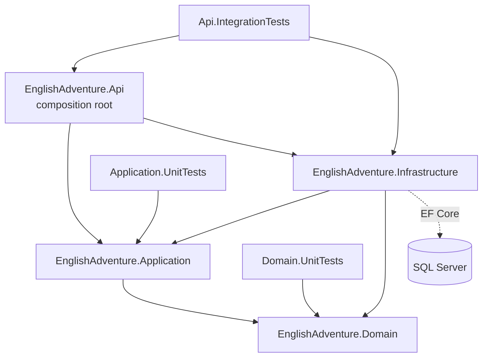
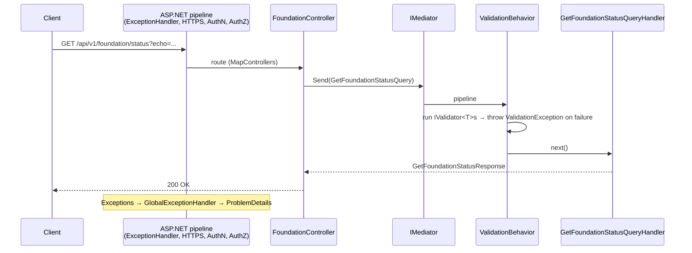

# Architecture Overview

> **Superseded in part (2026-10-23):** the authentication foundation is now implemented. For current auth status see [project-status.md](../project-status.md) and ADR-4 to ADR-7 in [decisions.md](decisions.md). Sections below that describe auth as missing, the host failing, or "no migrations" reflect the earlier inspection.

> Based on an inspection of the source on 2026-10-23. It describes what the code **actually does**. Planned features are marked as such.
>
> Status legend: ✅ Implemented and verified · 🟡 Partially implemented · 📋 Planned, not implemented · ❓ Unknown / not verified

## 1. Solution structure

Solution: `EnglishAdventure.sln`. Shared settings: `Directory.Build.props` (`net10.0`, `Nullable=enable`, `ImplicitUsings=enable`, `AnalysisLevel=latest`, `TreatWarningsAsErrors=false`). There is no `global.json`. The SDK was verified with 10.0.402.

| Project | Responsibility | Status |
|---|---|---|
| `src/EnglishAdventure.Domain` | Domain model and rules. Currently holds only `DomainException` and the `AccountType` enum (`Admin=1, Parent=2, Child=3`). | 🟡 Skeleton only, no entities |
| `src/EnglishAdventure.Application` | Use cases (CQRS requests and handlers), validators, the MediatR pipeline, application exceptions, and ports (interfaces) for infrastructure. | 🟡 Foundation query works. Auth use cases exist but are not wired. |
| `src/EnglishAdventure.Infrastructure` | EF Core `DbContext`, entity configurations, Identity persistence types, refresh-token hashing. | 🟡 No port implementations, no migrations |
| `src/EnglishAdventure.Api` | Composition root, controllers, exception handling, OpenAPI/Scalar, health checks. | 🟡 Host fails to start (see §8) |
| `tests/EnglishAdventure.Domain.UnitTests` | Domain unit tests | ✅ 1 test |
| `tests/EnglishAdventure.Application.UnitTests` | Handler and pipeline unit tests | ✅ 3 tests |
| `tests/EnglishAdventure.Api.IntegrationTests` | `WebApplicationFactory<Program>` HTTP tests and optional SQL connectivity | 🟡 1 failing, 1 vacuous |

### NuGet packages (from the `.csproj` files)

| Project | Packages |
|---|---|
| Domain | none |
| Application | MediatR 14.2.0, FluentValidation 12.2.0, FluentValidation.DependencyInjectionExtensions 12.2.0, Microsoft.Extensions.DependencyInjection.Abstractions 10.0.13 |
| Infrastructure | Microsoft.EntityFrameworkCore.SqlServer 10.0.13, Microsoft.EntityFrameworkCore.Design 10.0.13 (private), Microsoft.AspNetCore.Identity.EntityFrameworkCore 10.0.13, Microsoft.Extensions.Configuration.Abstractions / DependencyInjection.Abstractions / Options.ConfigurationExtensions 10.0.13 |
| Api | Microsoft.AspNetCore.Authentication.JwtBearer 10.0.13 (referenced, **not configured**), Microsoft.AspNetCore.OpenApi 10.0.13, Scalar.AspNetCore 2.18.2 |
| Tests | xunit 2.9.3, xunit.runner.visualstudio 3.1.4, Microsoft.NET.Test.Sdk 17.14.1, coverlet.collector 6.0.4, Microsoft.AspNetCore.Mvc.Testing 10.0.13 (integration only) |

Restore reports that the transitive package `System.Security.Cryptography.Pkcs` 9.0.11 has known vulnerabilities (NU1902 moderate, NU1903 high). It enters through the Infrastructure package graph. The exact parent package was not verified.

## 2. Project references and dependency rules

These are the references actually in the `.csproj` files. They follow Clean Architecture:

- **Domain** must not reference any project or framework package.
- **Application** may reference Domain only, plus abstractions-level packages (MediatR, FluentValidation, DI abstractions). No ASP.NET Core, EF Core, or Identity types.
- **Infrastructure** implements Application ports and may reference Application and Domain.
- **Api** is the only place that knows about all layers. It references Infrastructure **only** to call `AddInfrastructure`.

No architecture tests (e.g. NetArchTest) enforce these rules. Code review is the only enforcement today.

## 3. Request lifecycle

The verified path today is `GET /api/v1/foundation/status`:

The intended general flow for business features is **Controller → `IMediator.Send` → `ValidationBehavior` → handler → Domain entities (rules) → Application port → Infrastructure (EF Core) → SQL Server**. No handler touches persistence yet, so the Domain and persistence steps are 📋 not exercised anywhere.

Middleware order in `Program.cs`: `MapOpenApi` and `MapScalarApiReference` (Development only), then `UseExceptionHandler`, `UseHttpsRedirection`, `UseAuthentication`, `UseAuthorization`, `MapControllers`, `MapHealthChecks("/health")`.

### Error mapping (`Api/ExceptionHandling/GlobalExceptionHandler.cs`)

| Exception | HTTP |
|---|---|
| `FluentValidation.ValidationException` | 400 + `errors` dictionary |
| `AuthenticationFailedException`, `RefreshTokenException`, `UnauthorizedException` | 401 |
| `AuthenticationForbiddenException` | 403 |
| `NotFoundException` | 404 |
| `DomainException` | 422 |
| anything else | 500. In non-Development environments the detail is replaced with a generic message. |

Body-less error responses (such as the JWT bearer 401 challenge) get a ProblemDetails body from `UseStatusCodePages`.

## 4. Where business rules live

- **Domain**: invariants and rules on entities/value objects. They raise `DomainException`, which maps to 422. Nothing uses this yet because no entities exist.
- **Application**: use-case orchestration, authorization checks at the use-case level, and input validation through FluentValidation.
- **Infrastructure**: no business rules, only technical concerns (persistence, hashing, token issuing).
- **Api**: HTTP mapping only.

Today the auth handlers make account-eligibility checks (`IsActive`, `IsLockedOut`) in Application against an `AuthenticatedUser` DTO. That is acceptable for an identity concern, but there is no `User` domain aggregate.

## 5. Dependency injection

Each layer exposes one extension method. `Api/DependencyInjection.AddEnglishAdventureServices` composes them:

| Method | Registers |
|---|---|
| `Application.AddApplication()` | MediatR handlers from the Application assembly, all FluentValidation validators, open-generic `ValidationBehavior<,>` (transient) |
| `Infrastructure.AddInfrastructure(config)` | `EnglishAdventureDbContext` with SQL Server. Throws at startup if `ConnectionStrings:EnglishAdventure` is missing. Migrations assembly is Infrastructure. |
| `Api.AddApiExceptionHandling()` | ProblemDetails and `GlobalExceptionHandler` |
| `Api.AddApiAuthentication()` | Bare `AddAuthentication()` and `AddAuthorization()`. No schemes and no policies (placeholder). |
| Api (inline) | Controllers, OpenAPI, health checks |

`Program.cs` sets `ValidateOnBuild = true` (always) and `ValidateScopes` (Development only).

**Not registered anywhere:** implementations of `IIdentityUserService`, `IAccessTokenIssuer`, `IRefreshTokenService`, `IUserContext`; ASP.NET Core Identity services (`AddIdentityCore` / `AddIdentity`); JWT bearer options. As a result, host build fails (§8).

## 6. Persistence and migrations

- `EnglishAdventureDbContext` derives from plain **`DbContext`**, not `IdentityDbContext`. It has no `DbSet`s. `OnModelCreating` calls `ApplyConfigurationsFromAssembly`.
- That scan picks up `ApplicationUserConfiguration` and `RefreshTokenConfiguration`, which implicitly add `ApplicationUser` (an `IdentityUser<Guid>` with `AccountType` and `IsActive`) and `RefreshToken` (table `RefreshTokens`, unique `TokenHash`, `RowVersion` concurrency, cascade to user) to the model.
- Identity tables (roles, user-roles, claims, logins, tokens) are **not** mapped because the context is not an `IdentityDbContext`. `ApplicationRole` is defined but unused.
- ❓ Whether the current model builds and what table name `ApplicationUser` would get have not been verified. The design-time host cannot start.
- **Migrations: none exist.** There is no `Persistence/Migrations` folder. The README documents the `dotnet ef` commands. The `dotnet-ef` tool was not checked or installed.
- Connection string name: `EnglishAdventure`. `appsettings.json` points at LocalDB and `appsettings.Development.json` at `localhost`. Both use Windows integrated auth and contain no credentials.
- The app does not run migrations at startup.

## 7. Testing architecture

| Project | What it covers | Notes |
|---|---|---|
| Domain.UnitTests | `DomainException` message | Placeholder pattern |
| Application.UnitTests | `ValidationBehavior` (valid/invalid), `GetFoundationStatusQueryHandler` | Hand-constructed, no mocks. Auth handlers have **no tests**. |
| Api.IntegrationTests | `/health` through `EnglishAdventureWebApplicationFactory` (Development, in-memory connection-string override); optional SQL `CanConnectAsync` | The SQL test silently returns (passes) when `ENGLISH_ADVENTURE_TEST_SQL_CONNECTION` is unset |

There is no test database strategy, no architecture tests, and no CI configuration.

## 8. Violations, gaps, and risks

| # | Issue | Severity |
|---|---|---|
| 1 | **The API host cannot start.** Auth handlers depend on four unregistered ports, and `ValidateOnBuild=true` rejects the container. `/health` integration test fails. | Blocking |
| 2 | `EnglishAdventureDbContext` is not an `IdentityDbContext<ApplicationUser, ApplicationRole, Guid>`. Identity stores cannot work. Roles are unmapped. | High |
| 3 | JwtBearer package referenced but no scheme, no options, no signing-key configuration | High (planned work) |
| 4 | Auth exceptions are not mapped in `GlobalExceptionHandler` and would return 500 instead of 401/403 | Medium |
| 5 | Vulnerable transitive `System.Security.Cryptography.Pkcs` 9.0.11 (NU1903 high) | Medium |
| 6 | No migrations, so the schema does not exist anywhere | Medium (expected at this stage) |
| 7 | No user-secrets setup (`UserSecretsId` absent), although the README recommends it | Low |
| 8 | The SQL integration test reports "Passed" when skipped. Use a real skip so results stay honest. | Low |
| 9 | Stale `EnglishAdventure.Api.http` (`/weatherforecast`). README says auth is "not implemented", but partial auth code exists. | Low |
| 10 | No architecture tests enforcing layer rules. No CI. Repository is not under git. | Low |
| 11 | "Modular monolith" is a decision, but there are no modules yet. Feature folders exist only inside the Application project. | Design note |
| 12 | `TargetFramework`, `Nullable`, and `ImplicitUsings` are repeated in every csproj despite `Directory.Build.props` | Cosmetic |
