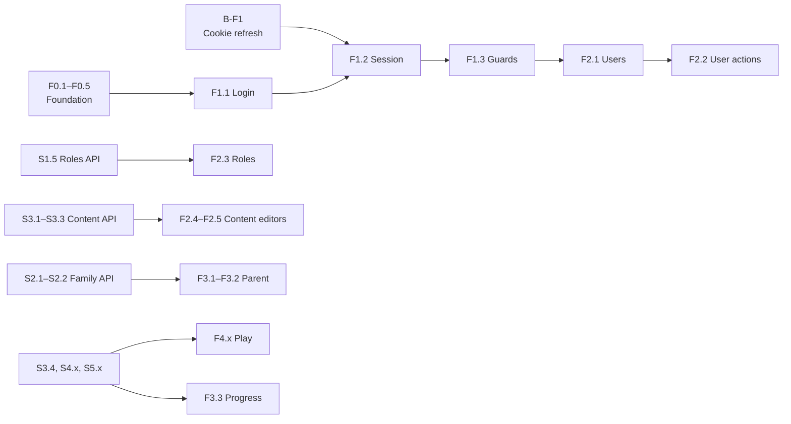

# Front-end Implementation Plan

| | |
|---|---|
| **Status** | Draft for review. No step is approved yet. |
| **Last updated** | 2026-10-23 |
| **Related** | [MVP plan (backend)](mvp-implementation-plan.md) · [Product decisions](../product/mvp-product-decisions.md) · [Backend status](../../BackEnd/docs/project-status.md) |

## Decisions already made (OQ-014, owner, 2026-10-23)

| Topic | Decision |
|---|---|
| Technology | React + Vite + TypeScript, single-page app in `FrontEnd/`. |
| App layout | One app with three areas: `/admin` (SuperAdmin, ContentAdmin), `/parent` (Parent), `/play` (child session). Shared auth, API client and design tokens. |
| Refresh token | httpOnly cookie set by the API. The access token lives in memory only, never in `localStorage`. Needs one small backend step (**B-F1**). |
| UI language | Vietnamese first, with i18n from day one. Lesson content stays in English. |

## How we work

Same process as the backend plan: **review → plan → approve → build → verify → record**, one step at a time.

Extra rules for the front end:
- **Contract first.** A screen is built only against a backend step that is ✅ Done. The API types are generated from the backend OpenAPI document, never written by hand.
- **No new packages without approval.** F0.1 lists the proposed packages; anything outside that list needs its own approval.
- **The UI never decides access.** Hiding a button by permission is only convenience; the API is the authority. Every 401/403 is handled gracefully.
- **No grading on the client** (PD-002, S4.1). The play screens send answers and show the server's result.
- **Tests:** logic and hooks have unit tests; every screen has at least one component test against mocked API responses.

Status values are the same as in the backend plan (✅ 🟢 🟡 ⚪ 💤).

## Overview

| Step | Title | Blocked by | Status |
|---|---|---|---|
| **Phase F0: Foundation** | | | |
| F0.1 | Approve the package list and folder structure | | ✅ Done 2026-10-23 |
| F0.2 | Scaffold the Vite + React + TS project, lint, format, scripts | | ✅ Done 2026-10-23 |
| F0.3 | API client: generated types, fetch wrapper, ProblemDetails, dev proxy | | 🟢 Ready |
| F0.4 | i18n, design tokens, layout shells for the three areas | | 🟢 Ready |
| F0.5 | Test setup (unit, component, API mocks) | | 🟢 Ready |
| **Phase F1: Authentication** | | | |
| B-F1 | **Backend:** refresh token in an httpOnly cookie | | ✅ Done 2026-10-23 |
| F1.1 | Login page | F0.3, F0.4 | ⚪ Waiting |
| F1.2 | Session: silent refresh, 401 retry, logout | B-F1, F1.1 | ⚪ Waiting |
| F1.3 | Route guards by user type and permission, 403/404 pages | F1.2 | ⚪ Waiting |
| **Phase F2: Admin area** | | | |
| F2.1 | Users: list, search, paging, detail | F1.3 (API: S1.3 ✅) | ⚪ Waiting |
| F2.2 | Users: create, activate/deactivate, set roles | F2.1 (role picker: S1.5) | ⚪ Waiting |
| F2.3 | Role management | S1.5 | ⚪ Waiting |
| F2.4 | Content: levels and lessons, publish | S3.1 | 🟡 Needs decision |
| F2.5 | Content: quiz and matching editors | S3.2, S3.3 | ⚪ Waiting |
| F2.6 | Badge definitions | S5.2 | ⚪ Waiting |
| **Phase F3: Parent area** | | | |
| F3.1 | Child profiles: create, rename, archive | S2.1 | 🟡 Needs decision |
| F3.2 | Start a child session ("hand the device to the child") | S2.2 | 🟡 Needs decision |
| F3.3 | Progress and rewards per child | S4.3, S5.3 | ⚪ Waiting |
| **Phase F4: Child play area** | | | |
| F4.1 | Kid-friendly visual style and play shell | F0.4 | ⚪ Waiting |
| F4.2 | Lesson map (Locked / Available / Completed) | S3.4, S4.2 | ⚪ Waiting |
| F4.3 | Quiz player | S4.1 | ⚪ Waiting |
| F4.4 | Matching player | S4.1 | ⚪ Waiting |
| F4.5 | Lesson result, points and badges | S5.3 | ⚪ Waiting |
| **Phase F5: Release hardening** | | | |
| F5.1 | End-to-end tests of the main flows | F4.x | ⚪ Waiting |
| F5.2 | Accessibility and tablet/phone layout review | | ⚪ Waiting |
| F5.3 | Security headers (CSP), production build, same-origin hosting | S7.x | 💤 Later |
| F5.4 | Front-end build and tests in CI | S6.5 | ⚪ Waiting |

## Working in parallel with the backend



1. **Now:** F0.1 → F0.5 and B-F1. Nothing here depends on an open product question.
2. **Next:** F1.x then F2.1 – F2.2. The user management API (S1.3) is already Done, so this is the first real feature end to end.
3. **Then:** each front-end step follows its backend step. While the backend builds S1.5 or S3.x, the front end builds the matching screen for the previous step.
4. **F2.4, F3.x, F4.x** wait for the same open questions as their backend steps (OQ-001, OQ-005, OQ-009, OQ-002, ...).

---

## Step details

### Phase F0: Foundation

**F0.1 Package list and structure (approval).**
- **Proposed packages** (exact versions are pinned at F0.2):

  | Purpose | Package |
  |---|---|
  | Build | `vite`, `@vitejs/plugin-react`, `typescript` |
  | UI | `react`, `react-dom` |
  | Routing | `react-router` |
  | Server state | `@tanstack/react-query` |
  | Forms and validation | `react-hook-form`, `zod`, `@hookform/resolvers` |
  | i18n | `i18next`, `react-i18next` |
  | Styling | `tailwindcss` (design tokens as CSS variables) |
  | Components (Admin, Parent) | shadcn/ui: component source copied into `src/components/ui` by its CLI, not a dependency. Pulls in `@radix-ui/*` (only for the components we add), `class-variance-authority`, `clsx`, `tailwind-merge` |
  | Icons | `lucide-react` |
  | API types | `openapi-typescript` (dev), `openapi-fetch` |
  | Quality | `eslint`, `typescript-eslint`, `eslint-plugin-react-hooks`, `prettier` |
  | Tests | `vitest`, `@testing-library/react`, `@testing-library/user-event`, `jsdom`, `msw` |
  | End-to-end (F5.1) | `@playwright/test` |

- **UI approach (owner, 2026-10-23):** start from the official Vite `react-ts` template; use shadcn/ui for the Admin and Parent areas; the Play area gets its own custom components (it may reuse shadcn primitives such as Dialog). Each shadcn component is added only when a step needs it.
- **Not used:** full admin dashboard templates (TailAdmin, Refine, React-Admin, ...) and packaged component libraries (MUI, Ant Design). They bring many unused packages and their own auth handling, which conflicts with the cookie session.
- **Folder structure** (feature-first):

  ```
  FrontEnd/
    src/
      app/           # router, providers, layout shells per area
      api/           # generated schema.d.ts, client, ProblemDetails helpers
      auth/          # session store, refresh, guards, login page
      features/
        admin-users/
        admin-roles/
        content/
        family/
        play/
      components/
        ui/          # shadcn/ui components (generated, then owned by us)
                     # other shared UI composed from them (DataTable, FormField, ConfirmDialog, ...)
      lib/           # utils.ts (cn helper for shadcn)
      i18n/          # vi.json, en.json
      styles/        # tokens.css
      test/          # MSW handlers, render helpers
  ```

- *Done when:* the owner approves or edits the list and the structure.

**F0.2 Scaffold.** ✅ Done 2026-10-23 on Node 24.22.1. What was built, and where it differs from the list below:
- From `create-vite@9.3.1` `react-ts` (config files only, demo assets dropped). Vite 8.3.5, React 19.3.1, TypeScript 6.0.3 (`strict`, `noUncheckedIndexedAccess`; no `baseUrl`, deprecated in TS 6), Tailwind 4.3.3 via `@tailwindcss/vite`.
- The template now ships **oxlint**; it was replaced by ESLint 10 + `typescript-eslint` + `eslint-plugin-react-hooks` as approved (plus `@eslint/js`, ESLint's own recommended rules).
- **shadcn/ui** (`radix-nova` style, Nova preset) brings its current packages, which differ from the F0.1 guess: `radix-ui` (one package instead of `@radix-ui/*`), `cn` (shadcn's own replacement for `clsx` + `tailwind-merge`), `lucide-react`, `tw-animate-css`, `@fontsource-variable/geist` (includes a Vietnamese subset), and `shadcn` itself as a dev dependency (its CSS is imported at build time). `button.tsx` was added by init; it is kept for F1.1.
- Exact versions (`.npmrc` `save-exact`, `engine-strict`), `.nvmrc` = 24, `engines.node >= 22.12`.
- `npm audit`: 7 high findings (`braces` via `fast-glob`), all inside the dev-only `shadcn` CLI; nothing in the shipped bundle (`npm audit --omit=dev` is clean). Revisit when shadcn updates.
- `api:types` moves to F0.3 with `openapi-typescript`.
- Verified: `npm run lint`, `npm run build`, `npm test` (one smoke test), `npm run format:check` pass; the dev server serves the app.

Original scope:
- Node 24 LTS (or at least 22.12), npm. The machine has 20.17, which is end-of-life (April 2026) and below Vite 8's minimum (20.19); the owner upgrades Node first. The version is pinned in `FrontEnd/.nvmrc` and `package.json` `engines`.
- Vite React TS template in `FrontEnd/`; TypeScript `strict`; path alias `@/` → `src/`.
- Scripts: `dev`, `build`, `preview`, `lint`, `format`, `test`, `api:types`.
- `.gitignore`: add `node_modules/`, `dist/`, `.env.local`.
- Tailwind set up, then `npx shadcn init` (creates `components.json`, `src/lib/utils.ts`, theme CSS variables). No components added yet.
- `FrontEnd/README.md` (how to run) and `FrontEnd/CLAUDE.md` (conventions).
- *Done when:* `npm run build`, `npm run lint` and `npm test` pass on an empty app.

**F0.3 API client.**
- `npm run api:types` reads `http://localhost:5063/openapi/v1.json` and writes `src/api/schema.d.ts` (committed, so the build does not need the API running).
- One `openapi-fetch` client with: base URL `/api`, the bearer token from the session store, `credentials: 'include'` for the auth endpoints.
- ProblemDetails mapping: 400 → field errors for forms, 401 → refresh then retry once, 403 → "no permission", 404, 409 → "changed by someone else, reload", 422 → rule message, 500 → generic error.
- **Dev proxy:** Vite proxies `/api` to `http://localhost:5063`, so the browser sees one origin and the backend needs no CORS in development.
- *Done when:* a test page calls `GET /api/v1/foundation/status` through the proxy.

**F0.4 i18n, tokens, shells.**
- `i18next` with `vi` as default and `en` as fallback. All UI text through `t()`; an ESLint rule or review checklist catches raw strings.
- Design tokens (`tokens.css`): colors, spacing, radius, font sizes; light theme first. Two flavors: neutral for admin/parent, bright and large for play.
- Layout shells: `AdminLayout` (side nav), `ParentLayout` (top nav), `PlayLayout` (full screen, big touch targets).
- *Done when:* the three empty areas render with Vietnamese labels.

**F0.5 Test setup.**
- Vitest + jsdom + Testing Library; MSW handlers typed from `schema.d.ts`.
- A `renderWithProviders` helper (router, query client, i18n).
- *Done when:* one sample component test and one hook test pass.

### Phase F1: Authentication

**B-F1 Backend: refresh token in an httpOnly cookie.** ✅ Done 2026-10-23. The owner left the details to Claude, decided from the backend code:
- **Opt-in per client:** the web app sends `X-EnglishAdventure-Client: web` on `login`, `refresh` and `logout`. Without the header nothing changes, so Scalar, the `.http` file and the existing tests keep the body-based flow.
- **Web mode:** `login` and `refresh` set cookie `ea_refresh` (`HttpOnly`, `Secure`, `SameSite=Strict`, `Path=/api/v1/auth`, expiry = refresh token expiry) and return `refreshToken: null`, so page scripts never see the token. `refresh` and `logout` take no body and read the cookie; `refresh` without a cookie is 401; `logout` deletes the cookie.
- **CSRF:** the cookie is read only with the custom header, which a cross-site page cannot send (no CORS), plus `SameSite=Strict`.
- **CORS:** none. The app is served from the same origin (Vite proxy now; reverse proxy in F5.3).
- **Code:** `Api/Authentication/RefreshTokenCookie.cs`, `AuthController`; `AuthTokensResponse.RefreshToken` is now nullable. No Application, Domain or database change.
- **Tests:** `RefreshTokenCookieSqlServerTests` (cookie attributes and empty body field, rotation and replay, no cookie → 401, cookie ignored without the header, logout revokes and deletes). All 139 tests pass with LocalDB.
- **Known limit:** Safari does not accept `Secure` cookies on `http://localhost`; develop with Chrome, Edge or Firefox, or use the API's https profile.

**F1.1 Login page.**
- Email + password form, validation messages in Vietnamese, ProblemDetails errors (wrong credentials, locked account, deactivated account).
- After login: `GET /me`, then redirect by `userType` (Admin → `/admin`, Parent → `/parent`).
- *Done when:* component tests cover success, 401, 403 and validation errors.

**F1.2 Session.**
- Access token and `/me` profile in memory (React context or a small store).
- On app start: call `refresh` (cookie) silently; signed in if it succeeds.
- On 401: one shared refresh request (single-flight), then retry the original request once; if refresh fails, go to login.
- Refresh shortly before `accessTokenExpiresAtUtc`.
- Logout: `POST logout`, clear memory and the query cache.
- Multiple tabs: a `BroadcastChannel` message signs out the other tabs.
- *Done when:* tests cover start-up refresh, concurrent 401s causing only one refresh, and logout.

**F1.3 Guards and error pages.**
- `RequireAuth`, `RequireUserType`, `RequirePermission` route wrappers using `/me` `permissions`.
- Navigation items are shown only when the permission is present.
- 403, 404 and "session expired" pages.
- *Done when:* a ContentAdmin cannot open the users area (UI) and gets the 403 page; the API still enforces it.

### Phase F2: Admin area

**F2.1 Users list and detail.** API: `GET /api/v1/admin/users`, `GET /{id}` (`users.read`).
- Table with search, paging (in the URL query string), user type, roles, active state.
- Detail page.

**F2.2 User actions.** API: `POST /`, `/deactivate`, `/activate` (`users.manage`), `PUT /{id}/roles` (`roles.manage`).
- Create Admin or Parent user (password rule shown up front: 12+ characters, upper, lower, digit, symbol).
- Activate/deactivate with a confirmation dialog explaining that sessions end.
- Role editor. Until S1.5 provides `GET /api/v1/admin/roles`, it offers the three system roles only.
- Server rules (no self-change, last SuperAdmin, Parent role only for Parents) are shown from the 422/409 messages, not re-implemented.

**F2.3 Role management.** After S1.5: list roles, create and edit with a permission checklist grouped by module; system roles read-only.

**F2.4 Levels and lessons.** After S3.1 (needs OQ-005): ordered lists with drag-and-drop or up/down buttons, Draft/Published/Archived badges, publish actions gated by `content.publish`, 409 handling for concurrent edits.

**F2.5 Quiz and matching editors.** After S3.2 and S3.3: inline validation mirroring the server rules for fast feedback, with the server as the authority; image input per OQ-011.

**F2.6 Badge definitions.** After S5.2.

### Phase F3: Parent area

All three steps depend on the child-identity decision (OQ-001, OQ-009, OQ-013).

- **F3.1 Child profiles:** list, create (nickname and avatar only, no email, PD-007 privacy rules), rename, archive.
- **F3.2 Child session:** the Parent picks a profile and enters child mode; the app switches to `/play` with the child token. Leaving child mode asks the Parent to sign in again (S2.2).
- **F3.3 Progress and rewards:** per-child completions, scores, points and badges.

### Phase F4: Child play area

- **F4.1 Visual style:** large touch targets (≥ 48 px), little text, icons and colors, sound effects optional and muted by default, tablet-first.
- **F4.2 Lesson map:** a path of lessons with Locked / Available / Completed states from the server.
- **F4.3 Quiz player** and **F4.4 Matching player:** one activity at a time, answers sent per activity (S4.1); no answer keys ever reach the client (S3.4). Resume follows OQ-012.
- **F4.5 Result screen:** score from the server, points and new badges with a small celebration.

### Phase F5: Release hardening

- **F5.1 E2E:** Playwright tests for login, admin user creation, and (later) one full lesson.
- **F5.2 Accessibility:** keyboard navigation for admin/parent, contrast, screen-reader labels; layout check at phone, tablet and desktop widths.
- **F5.3 Production:** CSP and security headers, `vite build` output served from the same origin as the API (reverse proxy or static hosting with `/api` routing).
- **F5.4 CI:** `npm ci`, lint, type check, tests and build on every push, together with S6.5.

## Change log

| Date | Change |
|---|---|
| 2026-10-23 | First draft. OQ-014 decided by the owner: React + Vite + TS, one app with three areas, refresh token in an httpOnly cookie, Vietnamese UI with i18n. |
| 2026-10-23 | Owner chose shadcn/ui for the Admin and Parent areas (no admin dashboard template). F0.1 package list and structure updated. |
| 2026-10-23 | F0.1 approved by the owner. B-F1 done (opt-in cookie via `X-EnglishAdventure-Client: web`). |
| 2026-10-23 | Owner upgraded to Node 24 LTS. F0.2 done (Vite 8, React 19, TS 6, Tailwind 4, shadcn/ui, ESLint, Prettier, Vitest). F0.3–F0.5 Ready. |
