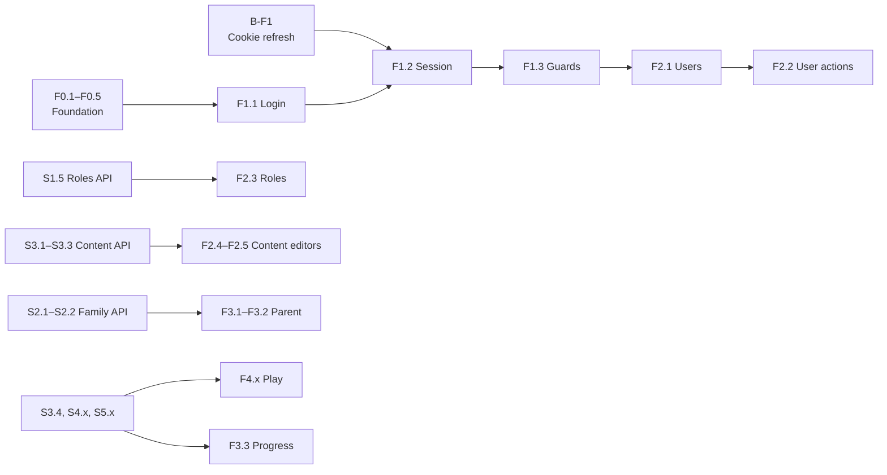

# Front-end Implementation Plan

| | |
|---|---|
| **Status** | Draft for review. No step is approved yet. |
| **Last updated** | 2026-10-23 |
| **Related** | [MVP plan (backend)](mvp-implementation-plan.md) · [Product decisions](../product/mvp-product-decisions.md) · [Backend status](../../BackEnd/docs/project-status.md) |

## Decisions already made (OQ-014, owner, 2026-10-23)

| Topic | Decision |
|---|---|
| Technology | React + Vite + TypeScript, single-page app in `FrontEnd/`. |
| App layout | One app with four areas, each in its own folder (`src/areas/{public,admin,parent,kids}`) with shared code in `src/shared`: the public site (`/`, `/login`, `/register`), `/admin` (SuperAdmin, ContentAdmin), `/parent` (Parent), `/kids` (child session). ESLint keeps the areas from importing each other. *(Restructured by the owner's decision, 2026-10-23: R1.)* |
| Refresh token | httpOnly cookie set by the API. The access token lives in memory only, never in `localStorage`. Needs one small backend step (**B-F1**). |
| UI language | Vietnamese first, with i18n from day one. Lesson content stays in English. |

## How we work

Same process as the backend plan: **review → plan → approve → build → verify → record**, one step at a time.

Extra rules for the front end:
- **Contract first.** A screen is built only against a backend step that is ✅ Done. The API types are generated from the backend OpenAPI document, never written by hand.
- **No new packages without approval.** F0.1 lists the proposed packages; anything outside that list needs its own approval.
- **The UI never decides access.** Hiding a button by permission is only convenience; the API is the authority. Every 401/403 is handled gracefully.
- **No grading on the client** (PD-002, S4.1). The play screens send answers and show the server's result.
- **Tests:** logic and hooks have unit tests; every screen has at least one component test against mocked API responses.

Status values are the same as in the backend plan (✅ 🟢 🟡 ⚪ 💤).

## Overview

| Step | Title | Blocked by | Status |
|---|---|---|---|
| **Phase F0: Foundation** | | | |
| F0.1 | Approve the package list and folder structure | | ✅ Done 2026-10-23 |
| F0.2 | Scaffold the Vite + React + TS project, lint, format, scripts | | ✅ Done 2026-10-23 |
| F0.3 | API client: generated types, fetch wrapper, ProblemDetails, dev proxy | | ✅ Done 2026-10-23 |
| F0.4 | i18n, design tokens, layout shells for the three areas | | ✅ Done 2026-10-23 |
| F0.5 | Test setup (unit, component, API mocks) | | ✅ Done 2026-10-23 |
| **Phase F1: Authentication** | | | |
| B-F1 | **Backend:** refresh token in an httpOnly cookie | | ✅ Done 2026-10-23 |
| F1.1 | Login page | | ✅ Done 2026-10-23 |
| F1.2 | Session: silent refresh, 401 retry, logout | | ✅ Done 2026-10-23 |
| F1.3 | Route guards by user type and permission, 403/404 pages | | ✅ Done 2026-10-23 |
| **Phase FP: Public site** | | | |
| R1 | Restructure the source by area; `/play` → `/kids`; texts per area; import boundaries | | ✅ Done 2026-10-23 |
| P1 | Landing page (product, steps, promises to parents) with sign-in and register | | ✅ Done 2026-10-23 |
| F-R1 | Registration form | | ✅ Done 2026-10-23 |
| F-R2 | Email confirmation page, resend link | | ✅ Done 2026-10-23 |
| **Phase F2: Admin area** | | | |
| F2.1 | Users: list, search, paging, detail | | ✅ Done 2026-10-23 |
| F2.2 | Users: create, activate/deactivate, set roles | | ✅ Done 2026-10-23 (role list: S1.5) |
| F2.3 | Role management | S1.5 | ⚪ Waiting |
| F2.4 | Content: levels and lessons, publish | | ✅ Done 2026-10-24 |
| F2.7 | Content: word bank editor and learn-step cards (PD-011) | | ✅ Done 2026-10-24 |
| F2.5 | Content: quiz and matching editors (pick words from the word bank) | | ✅ Done 2026-10-24 |
| F2.8 | Content: boss challenge editor (PD-011) | | ✅ Done 2026-10-24 |
| F2.9 | Content: word movement and sound for the discovery walk (PD-013) | S3.9 | ✅ Done 2026-10-24 |
| F2.6 | Badge definitions | S5.2 | ⚪ Waiting |
| **Phase F3: Parent area** | | | |
| F3.1 | Child profiles: list, create, edit, archive, restore (several per Parent) | | ✅ Done 2026-10-24 |
| F3.2 | Start a child session ("hand the device to the child") | | ✅ Done 2026-10-24 |
| F3.3 | Progress and rewards per child | S4.3, S5.3 | ⚪ Waiting |
| **Phase F4: Child play area** | | | |
| F4.1 | Kid-friendly visual style and kids shell | | ⚪ Waiting (shell and theme exist since F0.4) |
| F4.2 | Adventure map: levels, lessons (Locked / Available / Completed), best stars, boss | S4.2 for locks and stars | 🟡 Sea-and-islands map without locks done 2026-10-24 |
| F4.6 | Learn step: word cards before the activities (PD-011) | | ✅ Done 2026-10-24 (the cards are now F4.8's review) |
| F4.8 | Discovery walk, review cards and speaking practice (PD-013) | S3.9 | ✅ Done 2026-10-24 |
| F4.3 | Quiz player | | ✅ Done 2026-10-24 |
| F4.4 | Matching player | | ✅ Done 2026-10-24 |
| F4.7 | Boss battle screen: boss health bar, victory and level-up (PD-011) | S4.2 | 🟡 Health bar and victory message done with F4.3; level-up waits for S4.2 |
| F4.5 | Lesson result: stars, points and badges | S5.3 | ⚪ Waiting |
| **Phase F5: Release hardening** | | | |
| F5.0 | Split the bundle per area (lazy routes) | | ✅ Done 2026-10-23 |
| F5.1 | End-to-end tests of the main flows | F4.x | ⚪ Waiting |
| F5.2 | Accessibility and tablet/phone layout review | | ⚪ Waiting |
| F5.3 | Security headers (CSP), production build, same-origin hosting | S7.x | 💤 Later |
| F5.4 | Front-end build and tests in CI | S6.5 | ⚪ Waiting |

## Working in parallel with the backend



1. **Now:** F0.1 → F0.5 and B-F1. Nothing here depends on an open product question.
2. **Next:** F1.x then F2.1 – F2.2. The user management API (S1.3) is already Done, so this is the first real feature end to end.
3. **Then:** each front-end step follows its backend step. While the backend builds S1.5 or S3.x, the front end builds the matching screen for the previous step.
4. **F2.4, F3.x, F4.x** wait for the same open questions as their backend steps (OQ-001, OQ-005, OQ-009, OQ-002, ...).

---

## Step details

### Phase F0: Foundation

**F0.1 Package list and structure (approval).**
- **Proposed packages** (exact versions are pinned at F0.2):

  | Purpose | Package |
  |---|---|
  | Build | `vite`, `@vitejs/plugin-react`, `typescript` |
  | UI | `react`, `react-dom` |
  | Routing | `react-router` |
  | Server state | `@tanstack/react-query` |
  | Forms and validation | `react-hook-form`, `zod`, `@hookform/resolvers` |
  | i18n | `i18next`, `react-i18next` |
  | Styling | `tailwindcss` (design tokens as CSS variables) |
  | Components (Admin, Parent) | shadcn/ui: component source copied into `src/components/ui` by its CLI, not a dependency. Pulls in `@radix-ui/*` (only for the components we add), `class-variance-authority`, `clsx`, `tailwind-merge` |
  | Icons | `lucide-react` |
  | API types | `openapi-typescript` (dev), `openapi-fetch` |
  | Quality | `eslint`, `typescript-eslint`, `eslint-plugin-react-hooks`, `prettier` |
  | Tests | `vitest`, `@testing-library/react`, `@testing-library/user-event`, `jsdom`, `msw` |
  | End-to-end (F5.1) | `@playwright/test` |

- **UI approach (owner, 2026-10-23):** start from the official Vite `react-ts` template; use shadcn/ui for the Admin and Parent areas; the Play area gets its own custom components (it may reuse shadcn primitives such as Dialog). Each shadcn component is added only when a step needs it.
- **Not used:** full admin dashboard templates (TailAdmin, Refine, React-Admin, ...) and packaged component libraries (MUI, Ant Design). They bring many unused packages and their own auth handling, which conflicts with the cookie session.
- **Folder structure** (feature-first):

  ```
  FrontEnd/
    src/
      app/           # router, providers, layout shells per area
      api/           # generated schema.d.ts, client, ProblemDetails helpers
      auth/          # session store, refresh, guards, login page
      features/
        admin-users/
        admin-roles/
        content/
        family/
        play/
      components/
        ui/          # shadcn/ui components (generated, then owned by us)
                     # other shared UI composed from them (DataTable, FormField, ConfirmDialog, ...)
      lib/           # utils.ts (cn helper for shadcn)
      i18n/          # vi.json, en.json
      styles/        # tokens.css
      test/          # MSW handlers, render helpers
  ```

- *Done when:* the owner approves or edits the list and the structure.

**F0.2 Scaffold.** ✅ Done 2026-10-23 on Node 24.22.1. What was built, and where it differs from the list below:
- From `create-vite@9.3.1` `react-ts` (config files only, demo assets dropped). Vite 8.3.5, React 19.3.1, TypeScript 6.0.3 (`strict`, `noUncheckedIndexedAccess`; no `baseUrl`, deprecated in TS 6), Tailwind 4.3.3 via `@tailwindcss/vite`.
- The template now ships **oxlint**; it was replaced by ESLint 10 + `typescript-eslint` + `eslint-plugin-react-hooks` as approved (plus `@eslint/js`, ESLint's own recommended rules).
- **shadcn/ui** (`radix-nova` style, Nova preset) brings its current packages, which differ from the F0.1 guess: `radix-ui` (one package instead of `@radix-ui/*`), `cn` (shadcn's own replacement for `clsx` + `tailwind-merge`), `lucide-react`, `tw-animate-css`, `@fontsource-variable/geist` (includes a Vietnamese subset), and `shadcn` itself as a dev dependency (its CSS is imported at build time). `button.tsx` was added by init; it is kept for F1.1.
- Exact versions (`.npmrc` `save-exact`, `engine-strict`), `.nvmrc` = 24, `engines.node >= 22.12`.
- `npm audit`: 7 high findings (`braces` via `fast-glob`), all inside the dev-only `shadcn` CLI; nothing in the shipped bundle (`npm audit --omit=dev` is clean). Revisit when shadcn updates.
- `api:types` moves to F0.3 with `openapi-typescript`.
- Verified: `npm run lint`, `npm run build`, `npm test` (one smoke test), `npm run format:check` pass; the dev server serves the app.

Original scope:
- Node 24 LTS (or at least 22.12), npm. The machine has 20.17, which is end-of-life (April 2026) and below Vite 8's minimum (20.19); the owner upgrades Node first. The version is pinned in `FrontEnd/.nvmrc` and `package.json` `engines`.
- Vite React TS template in `FrontEnd/`; TypeScript `strict`; path alias `@/` → `src/`.
- Scripts: `dev`, `build`, `preview`, `lint`, `format`, `test`, `api:types`.
- `.gitignore`: add `node_modules/`, `dist/`, `.env.local`.
- Tailwind set up, then `npx shadcn init` (creates `components.json`, `src/lib/utils.ts`, theme CSS variables). No components added yet.
- `FrontEnd/README.md` (how to run) and `FrontEnd/CLAUDE.md` (conventions).
- *Done when:* `npm run build`, `npm run lint` and `npm test` pass on an empty app.

**F0.3 API client.** ✅ Done 2026-10-23. Built as below, with these details:
- `openapi-fetch` 0.17.0 and `openapi-typescript` 7.13.0. `openapi-typescript` declares a peer of TypeScript 5; a `package.json` `overrides` entry makes it use our TypeScript 6, and generation works. Remove the override when it supports TS 6.
- `src/api/schema.d.ts` is generated (945 lines, all current endpoints) and excluded from ESLint and Prettier.
- `src/api/client.ts`: `api` client on `window.location.origin`, a bearer middleware fed by `setAccessTokenProvider` (wired by the session in F1.2), `webClientHeaders` for the cookie mode, and `unwrap()` that returns data or throws `ApiError`.
- `src/api/problem-details.ts`: `ApiError` with `kind` (validation, unauthorized, forbidden, not-found, conflict, rule, server, network), the ProblemDetails body, and `fieldErrors` with camelCase keys (`Email` and `$.email` become `email`). 10 unit tests.
- Changed from the plan: no `credentials: 'include'`. The app and API share one origin, so fetch's default `same-origin` already sends the cookie. The 401 → refresh → retry part moves to F1.2 with the session.
- Proxy: `/api` → `http://localhost:5063` (override with `API_PROXY_TARGET`), port 5173 fixed (`strictPort`).
- Backend fix: with the API's `https` profile, `UseHttpsRedirection` answered the proxy with `307 → https://localhost:7078`, the browser followed it to another origin, and the request failed with a CORS error. `Program.cs` now skips HTTPS redirection in Development only; production keeps it.
- Verified through the proxy against the running API: `foundation/status` 200, web `refresh` without cookie 401 ProblemDetails, `/me` without token 401. The temporary `App.tsx` shows the API status; F0.4 replaces it.

Original scope:
- `npm run api:types` reads `http://localhost:5063/openapi/v1.json` and writes `src/api/schema.d.ts` (committed, so the build does not need the API running).
- One `openapi-fetch` client with: base URL `/api`, the bearer token from the session store, `credentials: 'include'` for the auth endpoints.
- ProblemDetails mapping: 400 → field errors for forms, 401 → refresh then retry once, 403 → "no permission", 404, 409 → "changed by someone else, reload", 422 → rule message, 500 → generic error.
- **Dev proxy:** Vite proxies `/api` to `http://localhost:5063`, so the browser sees one origin and the backend needs no CORS in development.
- *Done when:* a test page calls `GET /api/v1/foundation/status` through the proxy.

**F0.4 i18n, tokens, shells.** ✅ Done 2026-10-23. Built as below, with these details:
- Packages: `react-router` 8.5.0 (needs Node ≥ 22.22, so `engines` was raised), `i18next` 26.5.6, `react-i18next` 17.1.3.
- **i18n** (`src/i18n`): `vi.json` and `en.json`, `vi` default, `en` fallback. Keys are type-checked against `vi.json` (`i18next.d.ts`), so a wrong key fails the build. The language choice is kept in `localStorage` (wrapped in try/catch) and sets `<html lang>`. Tests check that both files have the same keys and no empty text.
- Raw strings: no ESLint plugin (not approved). Covered by the review checklist in `FrontEnd/CLAUDE.md` and by the typed keys.
- **Tokens:** the shadcn CSS variables in `src/index.css` are the neutral tokens (Admin, Parent). `src/styles/play.css` overrides them under `.theme-play`: warm background, orange primary, sky secondary, larger radius and text. Dark mode is not in scope yet.
- **Routes** (`src/app/router.tsx`): `/` temporary home with the three areas and the API status; `/admin` (Overview, Users, Roles, Content); `/parent` → `/parent/children` (Children, Progress); `/play`; a 404 page and a route error page. Pages are placeholders ("Coming soon").
- **Shells** (`src/app/layouts`): `AdminLayout` (side nav, top bar on phones), `ParentLayout` (top nav), `PlayLayout` (full screen, play theme, 48px+ touch targets). A shared `AreaNav` and `LanguageSwitcher`.
- Verified: type check, lint, 13 tests and build pass; the dev server serves every route.
- Follow-up for F5: the bundle is 420 kB (136 kB gzip); split areas with lazy routes once real screens exist.

Original scope:
- `i18next` with `vi` as default and `en` as fallback. All UI text through `t()`; an ESLint rule or review checklist catches raw strings.
- Design tokens (`tokens.css`): colors, spacing, radius, font sizes; light theme first. Two flavors: neutral for admin/parent, bright and large for play.
- Layout shells: `AdminLayout` (side nav), `ParentLayout` (top nav), `PlayLayout` (full screen, big touch targets).
- *Done when:* the three empty areas render with Vietnamese labels.

**F0.5 Test setup.** ✅ Done 2026-10-23. Built as below, with these details:
- Packages: `@testing-library/react` 16.3.3 (+ its peer `@testing-library/dom`), `@testing-library/user-event`, `jsdom` 30, `msw` 3.0.3, and `@tanstack/react-query` 5.104.5 (approved in F0.1, needed for the query-client provider). `@testing-library/jest-dom` was not added (not approved); tests use plain `expect`.
- `src/test/setup.ts`: MSW server for every test, `onUnhandledFrame: 'error'` (MSW 3's name for `onUnhandledRequest`) so an unmocked request fails; cleanup, handler reset, and language reset to `vi` after each test.
- `src/test/api-mocks.ts`: `mockApi(method, path, resolver)` checks the path and the success body against `schema.d.ts`, so mocks break when the backend contract changes; `problem(status, details)` returns a backend-shaped ProblemDetails.
- `src/test/render.tsx`: `renderWithProviders`, `renderRoutes` (real route tree in a memory router), `renderHookWithProviders`; each returns a `user-event` instance and the query client.
- App changes: `createQueryClient()` (no retry on 4xx, 30 s stale time) wired in `main.tsx`; routes moved to `src/app/routes.tsx` (the browser router is created in `main.tsx`); the home page's API check is now the `useApiStatus` query hook; the API client looks up `fetch` per request so MSW can intercept it.
- Tests (22): hook test (`useApiStatus` success and 503), component test (`HomePage`: area links, API status, language switch), route tests (admin shell with active link, `/parent` redirect, play theme, 404 and back home), plus the earlier unit tests.

Original scope:
- Vitest + jsdom + Testing Library; MSW handlers typed from `schema.d.ts`.
- A `renderWithProviders` helper (router, query client, i18n).
- *Done when:* one sample component test and one hook test pass.

### Phase F1: Authentication

**B-F1 Backend: refresh token in an httpOnly cookie.** ✅ Done 2026-10-23. The owner left the details to Claude, decided from the backend code:
- **Opt-in per client:** the web app sends `X-EnglishAdventure-Client: web` on `login`, `refresh` and `logout`. Without the header nothing changes, so Scalar, the `.http` file and the existing tests keep the body-based flow.
- **Web mode:** `login` and `refresh` set cookie `ea_refresh` (`HttpOnly`, `Secure`, `SameSite=Strict`, `Path=/api/v1/auth`, expiry = refresh token expiry) and return `refreshToken: null`, so page scripts never see the token. `refresh` and `logout` take no body and read the cookie; `refresh` without a cookie is 401; `logout` deletes the cookie.
- **CSRF:** the cookie is read only with the custom header, which a cross-site page cannot send (no CORS), plus `SameSite=Strict`.
- **CORS:** none. The app is served from the same origin (Vite proxy now; reverse proxy in F5.3).
- **Code:** `Api/Authentication/RefreshTokenCookie.cs`, `AuthController`; `AuthTokensResponse.RefreshToken` is now nullable. No Application, Domain or database change.
- **Tests:** `RefreshTokenCookieSqlServerTests` (cookie attributes and empty body field, rotation and replay, no cookie → 401, cookie ignored without the header, logout revokes and deletes). All 139 tests pass with LocalDB.
- **Fix 2026-10-23:** for web clients `refresh` now answers 401 without throwing when there is no cookie (every signed-out page load), and deletes a rejected cookie. Before, the debugger stopped on `RefreshTokenException` on each page load, and a revoked cookie stayed in the browser for up to 14 days because the exception handler cleared the Set-Cookie header.
- **Known limit:** Safari does not accept `Secure` cookies on `http://localhost`; develop with Chrome, Edge or Firefox, or use the API's https profile.

**F1.1 Login page.** ✅ Done 2026-10-23. Built as below, with these details:
- Packages: `react-hook-form` 7.90.0 and `zod` 4.6.7. **`@hookform/resolvers` was dropped:** versions 5 and 6 declare dozens of optional peer dependencies (effect, yup, joi, ...) that conflict on install. `src/lib/zod-resolver.ts` (about 30 lines) does the same job. shadcn `input`, `label`, `card` and `alert` were added (no new packages).
- `src/auth/session.ts`: a minimal in-memory session store (`sessionStore`, `useSession`) that also feeds the API client's bearer token. F1.2 adds refresh, retry and logout to it.
- `src/auth/sign-in.ts`: `signIn()` posts to `login` with the web-client header (refresh token goes to the cookie), loads `/me` with the new access token, then stores the session. `homePathFor()`: Admin → `/admin`, Parent → `/parent`, anything else → `/` (Child sign-in waits for OQ-001 / OQ-009).
- `src/auth/LoginPage.tsx` on `/login`: zod rules match `LoginCommandValidator` (email required, at most 256 characters, valid format; password required, at most 256). Messages are translation keys, so they follow a language switch. Errors: 401 → "wrong email or password" (the API gives a locked account the same answer on purpose), 403 → "account deactivated", 400 → the rejected fields are marked, network/5xx → "server unavailable". A signed-in user who opens `/login` is sent to their area. The temporary home page links to it.
- Tests (8): Admin and Parent sign-in with redirect, web-client header, request body and bearer token on `/me`; client validation; 401, 403, 400 and network errors; already signed in.
- Not checked against the real API with a real account (no test credentials here); the owner tries it with the SuperAdmin from `bootstrap-superadmin`. Bundle now 576 kB (183 kB gzip), see the F5 note.

Original scope:
- Email + password form, validation messages in Vietnamese, ProblemDetails errors (wrong credentials, locked account, deactivated account).
- After login: `GET /me`, then redirect by `userType` (Admin → `/admin`, Parent → `/parent`).
- *Done when:* component tests cover success, 401, 403 and validation errors.

**F1.2 Session.** ✅ Done 2026-10-23. Built in `src/auth/session.ts` and `src/api/client.ts`, no new packages:
- State `restoring` → `signed-in` / `signed-out` (with `reason: 'expired'` when a running session could not be renewed). `main.tsx` calls `restoreSession()` on load: `POST refresh` with the web header and no body, then `/me`.
- `refreshSession()` is single-flight and reloads `/me`, so permission changes show up within one refresh. A timer refreshes 60 s before the access token expires.
- 401 handling in the API client middleware: a copy of each non-auth request is kept, and on 401 the client asks the session for a new token once and repeats the request. It passes the rejected token, so requests that failed together share one refresh. Auth endpoints (including `/me`) are never retried, which prevents a refresh loop.
- **Tabs:** a `BroadcastChannel` signs out the other tabs and lets them restore after a sign-in elsewhere. Refreshes take turns through a Web Lock (`navigator.locks`): two tabs refreshing with the same cookie at once would look like token theft to the API (reuse detection) and end the whole session.
- `signOut()`: `POST logout` (cookie revoked and deleted), signed out locally even if the server is unreachable. `clearCacheOnSignOut()` drops the TanStack Query cache whenever the session ends.
- Tests: restore from cookie, no cookie, one refresh for concurrent callers, expiry, 401 → refresh → retry, failed renewal, three 401s sharing one refresh, sign-out (also offline), cache clearing.

Original scope:
- Access token and `/me` profile in memory (React context or a small store).
- On app start: call `refresh` (cookie) silently; signed in if it succeeds.
- On 401: one shared refresh request (single-flight), then retry the original request once; if refresh fails, go to login.
- Refresh shortly before `accessTokenExpiresAtUtc`.
- Logout: `POST logout`, clear memory and the query cache.
- Multiple tabs: a `BroadcastChannel` message signs out the other tabs.
- *Done when:* tests cover start-up refresh, concurrent 401s causing only one refresh, and logout.

**F1.3 Guards and error pages.** ✅ Done 2026-10-23:
- `src/auth/guards.tsx`: `RequireAuth` (optionally `userTypes`) as a layout route, and `RequirePermission` per page. Restoring shows "checking your session"; signed out → `/login` with `state.from`; wrong user type → full-page 403; missing permission → 403 inside the area layout. `src/auth/permissions.ts` mirrors the backend permission codes.
- Rules: `/admin` Admin users; Users needs `users.read`, Roles `roles.manage`, Content `content.manage`. `/parent` Parent users; Children `family.children.manage`, Progress `family.progress.read`. `/play` any signed-in user until the child session exists (S2.2).
- The menus hide items without permission (a ContentAdmin sees Overview and Content only). The Admin and Parent headers show the email and a sign-out button.
- After sign-in the user returns to the page they asked for, but only inside their own area and only for same-app paths. The login page explains an expired session.
- Tests: signed-out redirect with return path for four areas, restoring, Parent kept out of admin and Admin out of parent, ContentAdmin menu and embedded 403, sign-out, return after sign-in, return path outside the area ignored, expiry notice.

Original scope:
- `RequireAuth`, `RequireUserType`, `RequirePermission` route wrappers using `/me` `permissions`.
- Navigation items are shown only when the permission is present.
- 403, 404 and "session expired" pages.
- *Done when:* a ContentAdmin cannot open the users area (UI) and gets the 403 page; the API still enforces it.

### Phase FP: Public site

**R1 Source by area.** ✅ Done 2026-10-23 (owner request: avoid mixing up which part a fix is for).
- `src/areas/public`, `admin`, `parent`, `kids`: each has `routes.tsx` (its routes, pages loaded lazily), `index.ts` (the chunk entry exporting its pages), `i18n/{vi,en}.json` (its texts under one top-level key) and its pages, layout, features and tests. `src/shared`: api, auth, components (shadcn `ui/`, nav, account menu, error pages), i18n, lib, test, `routing.tsx` (`lazyPage`, `withPermission`). `src/app/routes.tsx` only puts the areas together.
- ESLint `no-restricted-imports` (built in, no package): an area imports only itself and `@/shared`; `@/shared` imports neither an area nor `@/app`; no `../` imports. Verified with deliberate violations.
- Texts: the shared file keeps `app`, `common`, `language`, `auth`, `errors`; the areas' files are collected with `import.meta.glob` so shared code never imports an area. Tests check key parity per file pair and that no two files share a top-level key. Keys renamed: `auth.login.*` → `public.login.*`, `play.*` → `kids.*`.
- `/play` → `/kids` (`KidsLayout`, `.theme-kids`, `kids.css` now loads with the kids chunk). The temporary home page and its API status check were removed.
- Files moved with `git mv` where they were tracked. No behaviour change apart from the renamed path; 95 tests pass.

**P1 Landing page.** ✅ Done 2026-10-23. `/` (`areas/public/LandingPage.tsx`, in the main bundle): sticky header (logo, section links, language, sign in, register; "my area" when signed in), hero with the two calls to action, features (lessons by level, mini-games, points and badges: PD-002 to PD-004), three steps (parent account, child profile, learn and follow), promises to parents (no child email or personal data, parent control, progress, content written by the team: PD-006/PD-007 privacy principles), closing call to action, footer. It makes no claim about price. `/register` explains that online registration opens soon (until F-R1). Tests: content and links, section anchors, signed-in variant, English, register page → sign-in.

**F-R1 / F-R2 Registration.** ✅ Done 2026-10-23, with backend S1.4 (PD-009).
- `/register`: email, password with the live checklist, repeat, consent checkbox linking to `/terms` and `/privacy` (provisional pages until OQ-008). Sends the interface language for the emails. → `/register/check-email` (says the link went out *if* the email has no account yet, valid 24 h; resend button).
- `/confirm-email?token=`: confirms (a query, not a mutation, so the page sends it once even under React StrictMode); success → sign in; unknown, expired or replaced → explanation and a resend form. Opening an already used link again shows success (fix 2026-10-23, after the owner reopened a used link and was told it was invalid). Every API request now gives up after 20 s (`AbortSignal.timeout` in `src/shared/api/client.ts`) and shows the retry state, so a page never shows "confirming…" forever when the backend does not answer (seen while the backend was paused in the Visual Studio debugger).
- Sign-in: 403 `email-not-confirmed` shows its own message and a resend button for the typed email; link to registration. 429 everywhere → "too many attempts, wait a minute" (`ApiError` kind `rate-limited`; `ApiError.code` carries the ProblemDetails code).
- Password rules and `PasswordChecklist` moved to `src/shared` (used by registration and admin user creation); their texts are now `password.*` in the shared translations.
- Tests (16): registration body and redirect, consent links, validation, 429, English emails, resend, confirm success / invalid / missing token, unconfirmed sign-in with resend, link to registration, legal pages. 109 front-end tests pass.
- **End to end** with the new API on a scratch LocalDB database through the Vite proxy: register 202 → sign-in 403 `email-not-confirmed` → email file with the link → confirm 204 → sign-in 200 with the cookie → registering the same email again only sends "you already have an account". Scratch database dropped afterwards.

### Phase F2: Admin area

**F2.1 Users list and detail.** ✅ Done 2026-10-23. API: `GET /api/v1/admin/users`, `GET /{id}` (`users.read`).
- `src/features/admin-users`: `useUserList` / `useUser` query hooks (the previous page stays visible while the next loads), `UsersListPage` on `/admin/users`, `UserDetailPage` on `/admin/users/:userId`, both behind `users.read`. shadcn `table` and `badge` added (no new packages).
- List: email (link to the detail), user type, roles, status (active / deactivated, temporarily locked), last sign-in in the interface language. Search by part of the email (trimmed, at most 256 characters, like the API) and paging by 20 are kept in the URL (`?q=...&page=2`). Loading, empty, no-match and error-with-retry states.
- Detail: the same fields plus created date and user ID; a missing user shows "not found".
- Names: the three system roles and the user types are translated; roles created at runtime (S1.5) keep their own name.
- Tests (9): list fields and badges, search with URL and request, clear search, no match, paging over 45 users, retry, open from the list, detail, 404, ContentAdmin blocked.
- Table with search, paging (in the URL query string), user type, roles, active state.
- Detail page.

**F2.2 User actions.** API: `POST /`, `/deactivate`, `/activate` (`users.manage`), `PUT /{id}/roles` (`roles.manage`). ✅ Done 2026-10-23.
- **Create** (`/admin/users/new`, `users.manage`; button on the list only with that permission): email, account type (Admin / Parent), password and confirmation. The password rule is checked live as a checklist and mirrors the backend `PasswordRules` with the same Unicode classes (`src/features/admin-users/password-rules.ts`). 409 marks the email as taken. Afterwards the detail page opens; for an Admin it says to choose roles next (a new Admin has no roles, so no permissions).
- **Status** (`users.manage`): "Deactivate" asks for confirmation in a dialog (sessions end); "Reactivate" needs none.
- **Roles** (`roles.manage`): checkboxes for SuperAdmin and ContentAdmin, plus any role the user already has, so a save never drops a role this list does not know. Warning when no role is left. A Parent user shows "always has the Parent role" instead.
- **Rule messages without parsing English server text:** the UI never offers changes to your own account, and offers Admin users only Admin roles, so a 422 from deactivate or roles can only be the last-SuperAdmin rule and is shown as such in Vietnamese.
- shadcn `alert-dialog`, `checkbox`, `radio-group` added (no new packages; `button.tsx` kept). Test setup gained a `ResizeObserver` stub for Radix in jsdom.
- Tests (23): password rules incl. Vietnamese letters; create Admin and Parent, live checklist, weak and mismatched password, duplicate email, no create button or page without `users.manage`; deactivate with confirm, cancel, last SuperAdmin, reactivate, own account, hidden without permission; save roles, no-role warning, unknown role kept, last SuperAdmin, Parent user.
- Follow-up: when S1.5 adds `GET /api/v1/admin/roles`, list the real roles. The bundle is now 681 kB (213 kB gzip), past Vite's 500 kB warning: lazy-load the areas soon (moved up from F5).

Original scope:
- Create Admin or Parent user (password rule shown up front: 12+ characters, upper, lower, digit, symbol).
- Activate/deactivate with a confirmation dialog explaining that sessions end.
- Role editor. Until S1.5 provides `GET /api/v1/admin/roles`, it offers the three system roles only.
- Server rules (no self-change, last SuperAdmin, Parent role only for Parents) are shown from the 422/409 messages, not re-implemented.

**F2.3 Role management.** After S1.5: list roles, create and edit with a permission checklist grouped by module; system roles read-only.

**F2.4 Levels and lessons.** ✅ Done 2026-10-24. API: S3.1 (`api/v1/admin/content/levels`, `.../lessons`).
- `src/areas/admin/content`: `LevelsPage` on `/admin/content` and `LevelDetailPage` on `/admin/content/levels/:levelId`, both behind `content.read-drafts` (the menu item too; it was `content.manage` before).
- Levels list: order, title (link), status badge, published/draft lesson counts, "show archived" checkbox; "Add level" dialog (title, description) that opens the new level.
- Level detail: title, description, status; edit dialog; publish / unpublish / archive. Lessons table: add, rename, publish / unpublish / archive per lesson. Archived lessons come last without position or actions; an archived level is read-only with a note.
- **Order with ↑ / ↓ buttons, no drag and drop** (owner's choice 2026-10-24: no new package, works with touch and keyboard). Each move sends the full new order.
- Buttons by permission: create, edit and move need `content.manage`; publish, unpublish and archive need `content.publish`. Archiving asks for confirmation and says it is final (PD-012).
- Errors: 409 says someone else changed the data; 404 that the item is gone; 422 on unpublish that children have started it, otherwise that the item or its level is archived. Every change (also a failed one) reloads the content queries. Forms check title (1–100) and description (≤ 500) like the backend.
- shadcn `textarea` added (no new packages). API types regenerated from the S3.1 backend.
- Tests (16): list, archived toggle, create and open, title check, move with the full order, read-only user, detail and lesson order, add/rename/reorder/publish with versions, archive confirmation, 409 reload, 422 unpublish, archived level read-only, unknown level, read-only detail, access without `content.read-drafts`, `moveInOrder`.

**F2.7 Word bank editor and learn cards.** ✅ Done 2026-10-24 (API: S3.6, S3.7).
- **Learn cards (S3.7):** a "Learn step" column with a checkbox per word in drafts (`PUT .../learn-card` with the lesson version) and Yes/No in published or archived lessons; a line counts the cards; a draft without any card says so before publishing. Tests (3): switch a card off with the version, no-card notice, published read-only.
- `LessonPage` on `/admin/content/lessons/:lessonId` (`content.read-drafts`); lesson titles on the level page link to it. It shows the lesson's status, publish / unpublish / archive, and the word bank `Words (n/12)`: position, picture thumbnail (placeholder when missing or broken; no referrer sent), English word, meaning.
- Draft lessons: add (disabled at 12 words), correct, ↑ / ↓, remove with confirmation. Published lessons: correct only, and the picture cannot be removed (note on the page). Archived lessons: read-only. A draft lists what is missing before it can be published (no words, or how many words lack a picture).
- Word dialog: English (1–50), meaning (1–100), picture address (`https://`, ≤ 2000) with a live preview, checked like the backend; a `word-duplicate` 422 marks the English field.
- Every word change sends the word bank's `lessonVersion`. **422 messages now come from the backend `code`** (`content-archived`, `content-started`, `lesson-structure-locked`, `lesson-not-ready`, `word-limit`, `word-duplicate`), which also fixes the F2.4 publish message for a lesson that is not ready.
- API types regenerated from the S3.6 backend. Tests (11): words and pictures, missing-picture notice, add with version, https check and preview, duplicate, correct/reorder/remove with versions, published structure lock, not-ready publish, 12-word limit, read-only user, unknown lesson, error codes.

**F2.5 Quiz editor.** ✅ Done 2026-10-24 (API: S3.2). The matching editor follows S3.3.
- `QuizEditor` on the lesson page, under the word bank: "Activities (n/4)", "Add quiz" (drafts; disabled under 2 words or at 4 activities). Each quiz is a card with ↑ / ↓, remove (with confirmation), its questions (form, prompt — picture, word or sentence —, correct and wrong answers) with ↑ / ↓, edit and remove, and "Add a question" (up to 10).
- `QuestionDialog`: form (radio), correct word (select), 1–3 wrong words (checkboxes). **Wrong words are suggested** (owner, 2026-10-24): the words after the correct one in the word bank, wrapping around, refreshed when the correct word changes and by a "Suggest" button; the Admin can change them. Fill-in sentence with exactly one `___`, checked like the backend.
- Published lessons: only fill-in sentences can be edited (the other fields are read-only); nothing can be added, moved or removed.
- The lesson page now tells what a draft lacks also for activities (none yet, or a quiz without questions), and maps the new 422 codes (`word-in-use`, `activity-limit`, `question-limit`, `question-invalid`).
- Tests (8): add a quiz and a question with suggestions, re-suggest and choose, fill-in sentence check, list/reorder/remove questions and remove a quiz, published sentence-only edit, two-word minimum, word in use, `suggestWrongWords`. The test API mock now registers `.../order` routes before `.../{id}` routes (MSW took "order" for an Id; also fixed for words).

**F2.8 Boss editor.** ✅ Done 2026-10-24 (API: S3.8).
- Level page: the boss is taken out of the lessons table and its order (a reorder sends regular lessons only) and shown in its own "End-of-level boss" section: picture, name (link), status, "Edit boss"; "Add boss" when there is none (`BossDialog`: name and https picture with preview), which opens the new boss. Archived bosses are listed by name. A draft level whose boss is not published says it needs one.
- Lesson page for a boss: picture and "Boss" label in the header, "Edit the boss's name and picture" (picture required once published), no word bank but a note on how many level words it can use; the activities editor works on the level's words. The publish checklist covers the boss picture, activities and words without pictures.
- New 422 messages: `boss-no-word-bank`, `boss-exists`, `level-needs-boss`, `boss-required`.
- Found and fixed while testing: the boss section heading and the name field shared the id `boss-title`.
- Tests (6): needs-boss notice and create-then-open, boss apart from the lessons and their order, `level-needs-boss`, boss page without word bank and picture check, words without pictures, edit name and picture.

**F2.5 Matching editor.** ✅ Done 2026-10-24 (API: S3.3).
- `ActivitiesEditor` (was `QuizEditor`) shows quizzes and matchings in their order; "Add matching" next to "Add quiz" (same 2-word minimum and 4-activity limit). The ↑ / ↓ and remove-with-confirmation controls are shared by both kinds (`ActivityActions`).
- Matching card: mode, number of pairs, and each word ↔ its picture or meaning; "Edit" in drafts; nothing to change once published.
- `MatchingDialog`: mode (word ↔ picture by default, or word ↔ meaning) and 2–6 words (the first four are preselected); the pairs keep the word bank's order. Maps `matching-invalid`.
- Tests (4): add with chosen words and mode, two-word minimum, show and change in a draft, published lock.

Earlier plan text: After S3.2 and S3.3: inline validation mirroring the server rules for fast feedback, with the server as the authority; image input per OQ-011.

**F2.6 Badge definitions.** After S5.2.

### Phase F3: Parent area

All three steps depend on the child-identity decision (OQ-001, OQ-009, OQ-013).

- **F3.1 Child profiles.** ✅ Done 2026-10-24 (`src/areas/parent/children`). `/parent/children` shows the active profiles as cards (avatar, nickname, edit, archive with confirmation), "n/3 in use", an "add" button disabled at the limit with an explanation, a friendly empty state, and an "archived" group with restore (and the reason when the limit or a nickname blocks it). A dialog creates and edits: nickname (1–50, the API's 409 shown on the field) and a radio grid of the 12 drawn avatars. Avatars are emoji on coloured circles in `src/shared/components/ChildAvatar.tsx` (shared, the kids area will use them); their names are translated for screen readers. The limit and avatar keys come from `GET options`. Tests (6) with a fake API applying the backend rules; `mockFamilyWithoutChildren()` for tests that only pass through the Parent area. 116 front-end tests pass.
- **F3.2 Child session.** ✅ Done 2026-10-24. Each active profile card has "Cho con học": after a confirmation ("you will need to sign in again to come back") `startChildSession()` (`src/shared/auth/session.ts`) calls `POST api/v1/auth/child-session` with the web header, loads `/me` and opens `/kids`, which greets the child with their avatar and nickname. `RequireAuth` has a `childSession` flag: the kids area accepts only child sessions, every other area only users' own sessions, and anyone in the wrong place goes to their own (`homePathFor`: a child session → `/kids`). The kids area's exit button asks first ("a parent will need to sign in again"), then signs out and opens the sign-in page. Other tabs follow a sign-in or a switch to child mode by restoring from the cookie. Tests (10): start, cancel, failure, exit with stay and leave, child session sent back from Parent and Admin pages, Parent sent back from `/kids`, the kids greeting; `signInAsChild()` in `src/shared/test/session.ts`. 124 front-end tests pass.
- **F3.3 Progress and rewards:** per-child completions, scores, points and badges.

### Phase F4: Child play area

- **F4.1 Visual style:** large touch targets (≥ 48 px), little text, icons and colors, sound effects optional and muted by default, tablet-first.
- **F4.2 Lesson map:** a path of lessons with Locked / Available / Completed states from the server.
  - *Redesigned 2026-10-24 (owner): a sea of islands.* Decided by the owner: 2.5D with the `motion` package (approved), sounds made in code (Web Audio, no files), the child's avatar animal as the explorer, the map before the locks. The child starts on the mainland (house, lighthouse, dock); each level is an island out at sea with its own look (palm, autumn, snow, desert, candy, crystal, repeating). Tapping an island: the explorer walks to the boat, rows across (oars, wake, splashes, camera follows with parallax clouds and horizon), steps off and the view dives into the island. On the island a footpath links a signpost per lesson, in order, to the boss's lair; tapping a stop walks there and opens the lesson; "Sail out to sea" goes back. The map remembers per child, on the device, the island and the last stop (`kids.adventure.<childId>`). Sea, music-box tune and effects with a Sound on/off toggle in the header (`kids.sound`). Games: chime and confetti for a right answer, shake for a wrong one, boss shakes and flashes when hit, stars pop in one by one with a fanfare, cards turn over, "Listen" says the English word. Everything is still with "reduce motion". Locks (an island opens after beating the previous boss) and stars wait for S4.2. Tests: 14 in `KidsPlay.test.tsx`.
  - *First version, 2026-10-24 (with F4.6):* `/kids` shows the child's greeting and the adventure map from `GET api/v1/play/map`: each level as an "island" (number, title, description), its lessons as large numbered buttons in order, and its boss as a highlighted button with its picture. Loading, empty and retry states. Every published lesson opens for now; locks and stars wait for S4.2.
- **F4.6 Learn step:** ✅ Done 2026-10-24. `/kids/lessons/:lessonId` (`LessonPlayPage`, `GET api/v1/play/lessons/{id}`, read once per visit because the server shuffles options): the word cards one at a time (picture, English word, meaning; "Card n of m", Back / Next, "Let's play!" on the last), then the games (F4.3/F4.4); "Go straight to the games" skips the cards. A boss starts with its picture and "Defeat …!" instead (no learn step). 404 says the lesson is not found; "Back to the map" everywhere. `KidsPicture` sends no referrer and keeps a placeholder for missing or broken pictures. The kids layout now centres "safely", so a long map starts at the top. Tests (6) in `KidsPlay.test.tsx`; tests that land on `/kids` use the new `mockEmptyAdventure()`.
- **F2.9 Word discovery fields:** ✅ Done 2026-10-24. The word dialog has "Movement while exploring" (Still, Walks, Hops, Flies, Swims, Crawls, Wiggles; default Still) and an optional sound address (https only, checked like pictures) with a "Play" button to try it. The word table has a "Discovery" column (movement, "with sound"). Both can be corrected in a published lesson. Test in `LessonPage.test.tsx`.
- **F4.8 Discovery walk and review (PD-013):** ✅ Done 2026-10-24. A lesson now goes: discovery walk → review cards → games. `DiscoveryWalk`: a scrolling island path (the level's island look, parallax clouds and hills); "Let's walk!" starts it, the explorer walks to each word in turn, whose picture moves by its movement (walking back and forth, hopping, flying in loops, swimming in a pond, crawling, wiggling, or breathing when still); on arrival the name pops up above it, the word's sound plays (`playClip`, at most 4 s, silent when sound is off) and the device's voice says the word; a panel shows the word, its meaning, "Listen" and "Its sound"; "Walk on", then "Review the cards". "Go to the cards" skips it. `ReviewCards` (the former learn step): each card has "Say it" where the browser has speech recognition (`play/speech.ts`: en-US, 5 guesses, lenient match: any guess, the word inside a short phrase, one letter off for words of 4+ letters); a right answer cheers with confetti, a wrong one shows what was heard; no microphone or silence get their own messages. Never scored or saved. Tests: 4 in `KidsPlay.test.tsx` (fake recognition), 3 in `speech.test.ts`.
- *Full screen and forest, 2026-10-24 (owner):* every scene sits on `adventure/Stage.tsx`, which fills the screen: the 1000 × 600 scene scales to the screen height (or to the width a narrow screen allows), layers keep drawing past it (`Layer` bleeds 1000 units each side), and the sky and ground colours continue above and below. The sound and exit buttons float top right (labels only from `sm`); lessons have a floating "Back to the map" and title. Cards and games are centred and zoom 1.2× / 1.4× on large screens (`kids-zoom`). The discovery walk is now a forest (`adventure/forest.tsx`): far canopy, light rays, mossy trees with vines, mist, the earth path with ferns, fireflies and dark leaves in front; the camera bobs while walking; each word hides in a bush with glowing eyes that rustles (sound) and parts to let it out with a sparkle; wind, crickets, birds and an owl (`startForest`).
- **F4.3 Quiz player** and **F4.4 Matching player:** ✅ Done 2026-10-24 (`GamePlayer`, `QuizStep`, `MatchingStep`). The attempt starts on "Start playing" ("Fight the boss!" for a boss), not on opening the lesson, and resumes at the first item not done (PD-012). Quiz: one question at a time, graded by the server per answer; the options lock, the right one gets a green tick and a wrong choice a red cross, then "Next". Matching: pick a word, then its picture or meaning; a miss shows "try again" without revealing the partner, a right match stays green; "All matched!" then "Next". Picture options are named "Picture n", never the word. A boss shows its health bar (`role=meter`, one notch per right answer or match). The result shows the 3 stars, "n of m right (p%)", a message (boss defeated / still standing), "Play again" (a new attempt) and "Back to the map". No answer keys reach the client (S3.4). Tests (10) in `KidsPlay.test.tsx` with a fake attempts API.
- **F4.5 Result screen:** score from the server, points and new badges with a small celebration. *The stars and score part is done with F4.3/F4.4; points and badges wait for S5.3.*

### Phase F5: Release hardening

- **F5.0 Code splitting.** ✅ Done 2026-10-23 (moved up: the bundle had passed Vite's 500 kB warning). Routes load each area from `src/app/areas/{admin,parent,play}.ts` with React Router `lazy`; the sign-in page is lazy too, so the form libraries (`zod`, `react-hook-form`) are not in the first download. Permission checks moved to pathless layout routes (`withPermission`) so pages stay lazy. A `PageLoading` fallback shows while the first chunk downloads. Initial JavaScript 681 kB → 441 kB (gzip 213 → 139 kB); admin 89 kB and sign-in about 150 kB load on demand. Tests: `renderRoutes` is now async and waits until the router has settled, including redirects.

- **F5.1 E2E:** Playwright tests for login, admin user creation, and (later) one full lesson.
- **F5.2 Accessibility:** keyboard navigation for admin/parent, contrast, screen-reader labels; layout check at phone, tablet and desktop widths.
- **F5.3 Production:** CSP and security headers, `vite build` output served from the same origin as the API (reverse proxy or static hosting with `/api` routing).
- **F5.4 CI:** `npm ci`, lint, type check, tests and build on every push, together with S6.5.

## Change log

| Date | Change |
|---|---|
| 2026-10-23 | First draft. OQ-014 decided by the owner: React + Vite + TS, one app with three areas, refresh token in an httpOnly cookie, Vietnamese UI with i18n. |
| 2026-10-24 | Misty, living sea (owner): hazier colours, mist banks, foam waves, gulls, fish shadows and leaping fish, far islands half hidden in mist; a level titled "Level n" shows just "Level n" on its sign (`labels.ts`). |
| 2026-10-24 | Sea map as an overview (owner): smaller islands scattered on three rows, drag to look around, signs "Level n · title" with the island name from the level description (also on the island); the forest no longer has trunks in front of the camera (they hid the pictures). |
| 2026-10-24 | Kids area full screen (owner): scenes on a `Stage` that fills the screen and scales to it, floating header buttons, larger cards and games on large screens; the discovery walk becomes a mysterious forest (hidden words in rustling bushes, light rays, mist, fireflies, near-leaf parallax, forest sounds). |
| 2026-10-24 | PD-013: F2.9 word movement and sound fields; F4.8 discovery walk, review cards with speaking practice (speech recognition). |
| 2026-10-24 | F4.2 redesigned as a sea of islands (owner): mainland, boat journeys, island footpaths, sounds made in code, game effects; package `motion` 14.1.0 approved. |
| 2026-10-24 | F4.3 and F4.4 done: quiz and matching players, resume, result with stars, boss health bar (part of F4.7). |
| 2026-10-24 | F4.6 done and F4.2 map without locks: adventure map, lesson page with the learn step, boss intro. |
| 2026-10-24 | F2.8 done: boss section on the level page, boss lesson page, boss rule messages. Content editing (F2.4–F2.8) is complete. |
| 2026-10-24 | F2.5 done: matching editor next to the quizzes (mode, 2–6 words). |
| 2026-10-24 | F2.5 quiz editor done: quizzes and questions on the lesson page, suggested wrong words, publish checklist for activities. |
| 2026-10-24 | F2.7 done: learn-card switches per word (drafts), card count and no-card notice. |
| 2026-10-24 | F2.7 word bank done: lesson page with the word bank editor; 422 messages from the backend rule codes. |
| 2026-10-24 | F2.4 done: levels and lessons screens (order with ↑ / ↓, publish, final archive, 409/422 messages). |
| 2026-10-24 | PD-011 (lesson design): added F2.7 word bank editor, F2.8 boss editor, F4.6 learn step, F4.7 boss battle; F4.2 becomes the adventure map with stars. |
| 2026-10-23 | Owner chose shadcn/ui for the Admin and Parent areas (no admin dashboard template). F0.1 package list and structure updated. |
| 2026-10-23 | F0.1 approved by the owner. B-F1 done (opt-in cookie via `X-EnglishAdventure-Client: web`). |
| 2026-10-23 | Owner upgraded to Node 24 LTS. F0.2 done (Vite 8, React 19, TS 6, Tailwind 4, shadcn/ui, ESLint, Prettier, Vitest). F0.3–F0.5 Ready. |
| 2026-10-23 | F0.3 done: generated API types, `openapi-fetch` client, `ApiError` mapping, Vite proxy. |
| 2026-10-23 | F0.4 done: typed i18n (vi/en), play theme tokens, router with Admin/Parent/Play shells. |
| 2026-10-23 | F0.5 done: Testing Library, MSW with schema-typed mocks, render helpers, TanStack Query client. Phase F0 complete; F1.1 is Ready. |
| 2026-10-23 | F1.1 done: login page with zod validation, in-memory session store, redirect by user type. `@hookform/resolvers` replaced by a local resolver. F1.2 Ready. |
| 2026-10-23 | F1.2 and F1.3 done: session restore, single-flight refresh with cross-tab lock, 401 retry, sign-out with cache clearing; route guards by user type and permission, 403 page, permission-filtered menus. Phase F1 complete; F2.1 Ready. |
| 2026-10-23 | F2.1 done: users list (search, paging in the URL) and user detail. F2.2 Ready. |
| 2026-10-24 | F3.2 done with backend S2.2: "let them learn" on each profile, child sessions land in `/kids`, guards by session kind, exit with confirmation. |
| 2026-10-24 | F3.1 done with backend S2.1: child profiles page, create/edit dialog with avatar picker, archive and restore. |
| 2026-10-23 | F-R1 and F-R2 done with backend S1.4: registration, check-email, confirm-email, resend, consent with provisional legal pages, unconfirmed sign-in handling. |
| 2026-10-23 | R1 and P1 done (owner request): source split into `areas/{public,admin,parent,kids}` and `shared` with ESLint boundaries, `/play` renamed `/kids`, public landing page. OQ-010 decided (PD-009); registration steps F-R1, F-R2 added. |
| 2026-10-23 | F5.0 done early: lazy routes per area and for sign-in; initial JavaScript 681 → 441 kB. |
| 2026-10-23 | F2.2 done: create user with live password rules, deactivate/reactivate with confirmation, role editor for Admin users (system roles until S1.5). |
