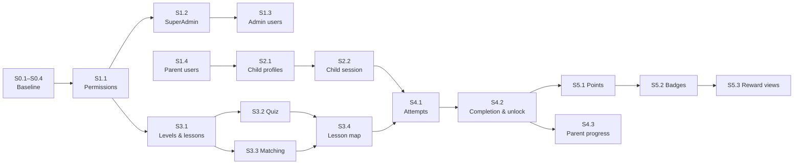

# MVP Implementation Plan

| | |
|---|---|
| **Status** | Draft for review. No step is approved yet. |
| **Last updated** | 2026-10-23 |
| **Related** | [Product decisions](../product/mvp-product-decisions.md) · [Domain model proposal](../../BackEnd/docs/architecture/domain-model-proposal.md) · [Backend status](../../BackEnd/docs/project-status.md) |

## How we work: one step = one review case

1. **Review:** the owner reads the step and answers the open questions that block it.
2. **Plan:** Claude inspects the current code and posts the exact scope, the affected files and the tests.
3. **Approve:** the owner approves or changes the scope.
4. **Build:** Claude implements only that scope. If the model changes, Claude also creates the migration (`dotnet ef migrations add`) and the owner reviews it.
5. **Verify:** build and tests pass. The owner applies migrations in Development with `POST /api/v1/database/migrate`.
6. **Record:** Claude updates the step's status here, `project-status.md` and any affected decision. The owner commits.

Rules for every step:
- Small and reviewable.
- Never drop or recreate the database.
- No new packages without approval.
- Keep the Clean Architecture boundaries.
- Business rules have unit tests. Security and access rules have integration tests.

**Status values:**

| Status | Meaning |
|---|---|
| ✅ Done | Built and verified |
| 🟢 Ready | Can start now |
| 🟡 Needs decision | Waiting for an open question to be answered |
| ⚪ Waiting | Waiting for another step |
| 💤 Later | Not needed for the MVP's first release |

## Overview

| Step | Title | Blocked by | Status |
|---|---|---|---|
| **Phase 0: Baseline** | | | |
| S0.0 | Authentication foundation (login, JWT, refresh rotation, logout, `/me`) | | ✅ Done |
| S0.1 | Commit the current work (owner) | | 🟢 Ready |
| S0.2 | Fix stale lines in `CLAUDE.md` and `overview.md` | | 🟢 Ready |
| S0.3 | Remove test accounts from `EnglishAdventure_Dev` (optional) | owner approval | 🟢 Ready |
| S0.4 | Approve the module structure (ADR-1) and add an architecture test | | ✅ Done 2026-10-23 |
| S0.5 | Replace ASP.NET Core Identity tables with our own tables in `dbo` (ADR-5) | | ✅ Done 2026-10-23 (owner applies the migration) |
| **Phase 1: Identity & Access** | | | |
| S1.1 | Permission catalog and policy-based authorization | | ✅ Done 2026-10-23 |
| S1.2 | Secure SuperAdmin bootstrap and role/permission sync | | ✅ Done 2026-10-23 |
| S1.3 | Admin user management (create users, assign roles) | | ✅ Done 2026-10-23 |
| S1.4 | Parent self-registration with email confirmation (PD-009) | | ✅ Done 2026-10-23 |
| S1.5 | Role management (create roles, choose their permissions) | | 🟢 Ready |
| **Phase 2: Family** | | | |
| S2.1 | Child profiles for Parents (up to 3 active per Parent) | | ✅ Done 2026-10-24 |
| S2.2 | Child session started by the Parent | | ✅ Done 2026-10-24 |
| **Phase 3: Content** | | | |
| S3.1 | Levels and lessons: manage, order, publish | OQ-005, S1.1 | 🟡 Needs decision |
| S3.2 | Quiz activities | S3.1, OQ-015 | ⚪ Waiting |
| S3.3 | Matching activities | S3.1, OQ-011 | ⚪ Waiting |
| S3.4 | Learner lesson map (read published content) | S3.2, S3.3 | ⚪ Waiting |
| S3.5 | Development seed content | OQ-006, S3.3 | 🟡 Needs decision |
| **Phase 4: Learning** | | | |
| S4.1 | Lesson attempts with server-side grading | OQ-002, OQ-012, S2.2, S3.4 | 🟡 Needs decision |
| S4.2 | Lesson completion and sequential unlocking | OQ-002, OQ-003, OQ-016, S4.1 | 🟡 Needs decision |
| S4.3 | Parent progress view | S4.2 | ⚪ Waiting |
| **Phase 5: Rewards** | | | |
| S5.1 | Points ledger | OQ-004, S4.2 | 🟡 Needs decision |
| S5.2 | Badges | OQ-004, S5.1 | 🟡 Needs decision |
| S5.3 | Rewards views for child and Parent | S5.2 | ⚪ Waiting |
| **Phase 6: Release hardening** | | | |
| S6.1 | Rate limiting on `login` and `refresh` | | ⚪ Waiting |
| S6.2 | Cleanup job: expired tokens, unconfirmed accounts after 7 days | | ⚪ Waiting |
| S6.3 | Fix the vulnerable `System.Security.Cryptography.Pkcs` package | owner approval | 🟢 Ready |
| S6.4 | Privacy: retention, deletion, log review | OQ-008 | 🟡 Needs decision |
| S6.5 | CI pipeline: build and test on every push | | ⚪ Waiting |
| **Later** | | | |
| S7.x | Azure hosting, Key Vault, Application Insights | stable MVP | 💤 Later |
| F.x | Front-end track, see the [front-end plan](frontend-implementation-plan.md) | | 🟢 Ready (F0.1, B-F1) |

## Suggested order

Admin content does **not** depend on the child-identity decision. So we can build content while OQ-001 is being decided.

1. **S0.1 → S0.4.** Clean baseline and an agreed module structure.
2. **S1.1 → S1.2.** Admins can sign in, and endpoints are protected by permissions.
3. **S3.1 → S3.4.** Admins can build real content. Meanwhile, decide OQ-001 / OQ-009 / OQ-010.
4. **S1.4 → S2.2.** Parents, child profiles, child sessions.
5. **S4.1 → S4.2 → S5.x → S4.3 / S5.3.** The learning loop and rewards.
6. **S1.3, S3.5, Phase 6.** Fit around the above. Phase 6 must be done before any public release.

---

## Step details

### Phase 0: Baseline

**S0.1 Commit the current work (owner).**
- The migrate endpoint, the test database fix and these documents are uncommitted.
- *Done when:* the working tree is clean.

**S0.2 Fix stale documentation.**
- `CLAUDE.md` says the API "does not start yet", calls auth "non-functional" and says user secrets aren't set up. All three are wrong.
- `overview.md` says "no migrations".
- *Done when:* the docs match the code. No code changes.

**S0.3 Remove test accounts from the dev database (optional).**
- Delete the 26 `@example.test` accounts, their refresh tokens and the test-created roles from `EnglishAdventure_Dev`.
- Only with explicit approval; this changes your database.
- *Done when:* `AspNetUsers` contains no `@example.test` rows.
- **Superseded by S0.5:** the `AspNet*` tables and their test accounts no longer exist.

**S0.4 Module structure (ADR-1).** ✅ Done 2026-10-23. The owner approved all 11 decisions (see ADR-1). Added `Domain/Common/Entity.cs`, moved `UserType` to `Domain/Enums/`, added `DomainArchitectureTests` and `ApplicationArchitectureTests`. No entities, tables or migrations.
- Approve or change the structure in the [domain model proposal](../../BackEnd/docs/architecture/domain-model-proposal.md):
  - The layer trees (§3) and the `Domain/Entities/<Module>` layout (§4).
  - The module rules (§10): one `DbContext`, one table prefix per module, references by ID only.
- If approved, move `Domain/Users/UserType.cs` to `Domain/Enums/` (a namespace change only; the database is unaffected).
- Add a reflection-based architecture test for the layer rules and the module rules (no new package).
- *Done when:* ADR-1 is marked decided and the test passes.

**S0.5 Own identity tables (ADR-5).** ✅ Done 2026-10-23. All six decisions approved by the owner.
- **Domain entities:** `User`, `UserRole`, `Role`, `RolePermission`, `Permission` in `Domain/Entities/Identity`.
- **Database:** tables in `dbo` with the `auth_` prefix (owner's choice). The migration history was reset by the owner: one standalone migration, `InitialCreate`, creates everything. The old `InitialIdentity` migration was deleted.
- **Package:** `Microsoft.AspNetCore.Identity.EntityFrameworkCore` replaced by `Microsoft.Extensions.Identity.Core` (password hashing only).
- **Behavior:** login, refresh, logout and `/me` are unchanged and covered by the existing tests.
- **Owner action:** apply the migration with `POST /api/v1/database/migrate` after restarting the API.

### Phase 1: Identity & Access

> **Owner decision 2026-10-23:** build user and role management in four steps, each reviewed separately:
> S1.1 permission checks → S1.2 first SuperAdmin → S1.3 user management → S1.5 role management.
> Approved choices:
> - Passwords need at least 12 characters with upper case, lower case, a digit and a symbol.
> - The first SuperAdmin comes from user secrets or environment variables.
> - Permissions are looked up per request, with a 1-minute cache.

**S1.1 Permission catalog and policy authorization.** ✅ Done 2026-10-23.
- **Catalog:** `Application/Authorization/Permissions.cs` holds the 9 permissions and `SystemRoles.cs` the 3 PD-008 roles with their defaults:
  - SuperAdmin gets every permission except `family.*`.
  - ContentAdmin gets `content.*`.
  - Parent gets `family.*`.
- **Checking:**
  - `[Authorize(Policy = Permissions.X.Y)]`. `PermissionPolicyProvider` builds each policy from the permission code, so nothing is registered by hand.
  - `PermissionAuthorizationHandler` reads the account's permissions through `IUserPermissionReader`: database lookup on each request, 1-minute cache, and empty for a deactivated account.
  - Role names in the token grant nothing.
- **Responses:** `/me` now returns `permissions`. The first protected endpoint is `GET /api/v1/admin/permissions` (`roles.manage`). 401 and 403 are ProblemDetails.
- **Migration:** none.
- **Tests:** catalog and system-role rules (unit); 401/403/200 through the real middleware (no database); real role → permission lookup and deactivation on SQL Server.

**S1.2 Secure SuperAdmin bootstrap.** ✅ Done 2026-10-23. Built as planned below. The command-line verbs are in `Api/CommandLine/CommandLineTasks.cs`, and the commands are `SyncSystemRolesCommand` and `BootstrapSuperAdminCommand` (`Application/Authorization/Commands`). Repositories (`IUserRepository`, `IRoleRepository`, `IPermissionRepository`) and `IUnitOfWork` were introduced. Verified by unit tests, a SQL integration test, and a CLI smoke test.
- **Includes:**
  - Command-line verbs on the API, not HTTP endpoints:
    - `sync-roles`: creates the catalog permissions and the 3 system roles, and gives the system roles their default permissions.
    - `bootstrap-superadmin`: runs `sync-roles`, then creates the first SuperAdmin.
  - Credentials from `Bootstrap:SuperAdmin:Email` / `Bootstrap:SuperAdmin:Password` (user secrets locally, environment variables elsewhere). Never in code, config files or logs.
  - Refuses (non-zero exit) when a SuperAdmin already exists.
  - Password rule: at least 12 characters with upper, lower, digit and symbol. It is reused by S1.3.
- **Replaces** the hand-written seed SQL for roles and permissions.
- *Done when:*
  - The first run creates the SuperAdmin, and a second run refuses.
  - That account can sign in and call `GET /api/v1/admin/permissions`.
  - Tests use a throwaway database.

**S1.3 Admin user management.** ✅ Done 2026-10-23. Built as listed below.
- `AdminUsersController` sends commands and queries from `Application/Users`.
- **Added rule** (`UserRoleRules`): a Parent user can only hold the Parent role, and an Admin user cannot hold it. A family account can never become an administrator.
- Rule violations return 422, unknown accounts or roles 404, duplicates and concurrent edits 409 (via `UnitOfWork`).
- Tests: validators (unit); 8 SQL end-to-end tests including last-SuperAdmin protection and session revocation.
- **Endpoints** (`api/v1/admin/users`):
  - `GET /` and `GET /{id}` (`users.read`).
  - `POST /` creates an Admin or Parent user (`users.manage`). A new Parent user gets the Parent role. No Child users until OQ-001 is decided.
  - `POST /{id}/deactivate` and `/activate` (`users.manage`).
  - `PUT /{id}/roles` (`roles.manage`).
- **Rules:**
  - Nobody can deactivate themselves or change their own roles.
  - The last active SuperAdmin cannot be deactivated or demoted.
  - Deactivating an account revokes its refresh tokens.
  - ContentAdmin can reach none of these endpoints.
- *Done when:* each rule has a test, and an unauthorized call returns 403.

**S1.5 Role management.** 🟢 Ready
- **Endpoints** (`api/v1/admin/roles`), all `roles.manage`:
  - `GET /` lists roles with their permissions.
  - `POST /` creates a role with a chosen set of catalog permissions.
  - `PUT /{id}` renames a role and changes its description and permissions.
  - `DELETE /{id}` deletes a role, only when no account has it.
- **Rules:**
  - Permissions come only from the catalog; they are never created through the API.
  - The 3 system roles cannot be deleted or renamed.
  - SuperAdmin always keeps every non-family permission.
  - Changes apply within the 1-minute permission cache.

**S1.4 Parent self-registration with email confirmation.** ✅ Done 2026-10-23. OQ-010 decided 2026-10-23 (PD-009). The owner approved the scope below and the four answers: production email provider later (development writes files); consent checkbox now, with provisional links to the terms and privacy pages until OQ-008; links valid 24 h; unconfirmed accounts deleted after 7 days by the S6.2 cleanup job.

*As built:* commands `RegisterParent`, `ConfirmEmail`, `ResendEmailConfirmation` (Application/Authentication); `User.RegisterParent` / `ConfirmEmail`; `User.Create` (administrators, bootstrap) counts as confirmed; `Consent.CurrentVersion` = `2026-10-23`; `IEmailSender` → `PickupDirectoryEmailSender` (`Email:PickupDirectory`, default `App_Data/emails`, git-ignored); `IAppLinks` → `WebApp:BaseUrl` (required, validated at start; `http://localhost:5173` in Development); unconfirmed or inactive sign-in → 403 with ProblemDetails `code` `email-not-confirmed` / `user-inactive`; rate limiter policies `sign-in` (10/min per address) and `registration` (5/min) with 429 ProblemDetails and `Retry-After` (`RateLimiting` settings). Migration `AddParentRegistration`: three `auth_users` columns, table `auth_email_confirmation_tokens`, existing users backfilled as confirmed (checked with the idempotent script on a scratch database that had a user). Tests: 6 domain, 9 validator, 10 SQL integration (all listed below); 165 backend tests pass.

**Scope as approved:**
- **Endpoints** (anonymous, `api/v1/auth`):
  - `POST register` with email, password (the S1.2 rule) and consent. Always answers `202 Accepted` with the same body, also when the email already has an account, so the endpoint never reveals who is registered. A taken email gets a "you already have an account" email instead.
  - `POST confirm-email` with the token from the link: confirms the account (`204`). An expired or used token gives `400`.
  - `POST resend-confirmation` with an email: always `202`; sends a new link only to an unconfirmed account.
- **Sign-in:** an unconfirmed Parent gets `403` with a distinct problem type (only after the correct password, like a deactivated account), so the web app can offer "resend the link". Users created by an Admin count as confirmed.
- **Domain and database** (migration): `User.EmailConfirmedAtUtc` (existing users backfilled as confirmed); `User.ConsentAcceptedAtUtc` and `ConsentVersion`; table `auth_email_confirmation_tokens` (SHA-256 hash only, like refresh tokens; 24 h lifetime; a new link voids the older unused ones; opening a used link again answers 204 without change).
- **Email:** `IEmailSender` in Application. Development implementation writes each email as a file to a local folder and logs the link; no package. The production provider is a separate decision (SMTP, SendGrid, Azure Communication Services, ...).
- **Abuse protection:** ASP.NET Core's built-in rate limiter on `register`, `resend-confirmation` and `login` (moves part of S6.1 forward).
- **Tests:** no account enumeration (same answer for new and taken emails), token hashing, expiry, single use, unconfirmed sign-in refused, Admin-created users unaffected, rate limit.
- **Questions for the owner:** (1) production email provider now or later; (2) the consent text and its version (links to terms and privacy pages that do not exist yet, part of OQ-008); (3) link lifetime (proposed 24 h); (4) delete accounts never confirmed after N days?
- *Done when:* the tests above pass and the front end (F-R1, F-R2) can register, confirm and sign in end to end.

### Phase 2: Family

**S2.1 Child profiles.** OQ-001 and OQ-013 decided 2026-10-24 (PD-010). **Owner answers 2026-10-24:** at most **3** active profiles per Parent (archived ones do not count); nicknames unique within a family; about 12 drawn animal avatars, never photos; archive and restore instead of delete.

*As built (✅ 2026-10-24):* `ChildProfile` with `MaxActivePerParent = 3` and the 12 `AvatarKeys` in the entity; `Nickname` value object; commands `CreateChildProfile`, `UpdateChildProfile`, `ArchiveChildProfile`, `RestoreChildProfile` and queries `ListChildProfiles`, `GetChildProfile` (`Application/Family`); `ChildProfilesController` on `api/v1/family/children` plus `GET options` (avatars and limit) for the web app. Limit → 422, nickname taken → 409 (checked in the handler, backed by the filtered unique index), another family's profile → 404 everywhere. The Nickname column has collation `Latin1_General_100_CI_AS` ("An" = "an", "An" ≠ "Ân"). Migration `AddChildProfiles`. Tests: 13 domain, 7 validator, 8 SQL integration (several profiles, the limit on create and restore, unique nicknames per family, reuse after archiving, update and restore, cross-family 404, 401/403, invalid input and options); 194 backend tests pass. Checked end to end on a scratch database (register → confirm → sign in → three profiles → fourth refused → duplicate nickname 409 → archive). The SuperAdmin role does not hold `family.*`, so admins cannot see families (PD-008).

Scope:
- **Domain** (`Domain/Entities/Family`): `ChildProfile` (aggregate root) with `ParentUserId`, `Nickname` (value object: 1–50 characters, trimmed), `AvatarKey` (one of a fixed set of drawn avatars, no photos), `Status` (Active, Archived), `CreatedAtUtc`, `ArchivedAtUtc?`. Rules: rename and change the avatar only while active; `IsOwnedBy(userId)`. No real name, birth date, photo or email (privacy principles).
- **Several profiles per Parent** (owner addition), with a cap on active profiles and a unique nickname within the family (questions below).
- **Endpoints** (`api/v1/family/children`, permission `family.children.manage`, Parent users only):
  - `GET /` (own profiles; archived ones on request) and `GET /{id}`.
  - `POST /` (nickname, avatar) and `PUT /{id}` (nickname, avatar).
  - `POST /{id}/archive` and `POST /{id}/restore`.
- **Ownership on the server:** every query filters by the signed-in Parent. Another family's profile ID answers 404, never 403, so IDs reveal nothing. A client-sent ID is never trusted on its own (PD-008).
- **Archive, not delete:** archiving hides the profile and stops learning but keeps the progress, and it can be restored. Permanent deletion of child data belongs to S6.4 (OQ-008).
- **Migration:** table `family_child_profiles` (FK to `auth_users`, restrict delete), index on `ParentUserId`, filtered unique index on (`ParentUserId`, normalized nickname) for active profiles, row version for concurrent edits (409).
- **Tests:** nickname and avatar rules (unit); the cap; unique nickname; archive and restore; cross-family 404 on every endpoint; an Admin, or a Parent without the permission, gets 403.
- **Questions for the owner:** (1) cap on active profiles per Parent (proposed 10); (2) nickname unique within a family (proposed yes, so the child picker is unambiguous); (3) avatars: a fixed set of about 12 drawn animal avatars (proposed), never photos; (4) archive and restore instead of delete (proposed).
- *Done when:* the tests above pass and the Parent area (F3.1) can create, edit, archive and restore profiles end to end.

**S2.2 Child session.** ✅ Done 2026-10-24. OQ-009 decided 2026-10-24 (PD-010, option B). **Owner answers:** a child session lasts like a Parent's (14 days, renewed with use); the exit button asks for confirmation only.

*As built:* the endpoint is `POST api/v1/auth/child-session` (body `childProfileId`), not under `family/children`: the web app's refresh cookie is only sent to `api/v1/auth`, and it is needed to end the Parent's session on the device. `learning.play` is in `Permissions.SessionOnly`, outside the role catalog, so no role (not even SuperAdmin, nor a role created in S1.5) can hold it. `PermissionAuthorizationHandler` asks `IUserPermissionReader.GetChildSessionPermissionsAsync` for child sessions. `IUserContext.ChildProfileId` comes from the token for the learning endpoints. `RefreshTokenCookie.Respond` is the one place that answers with tokens (cookie for the web app). Migration `AddChildSessions` (nullable `ChildProfileId` with a foreign key on `auth_refresh_tokens`). Tests: 1 domain, 1 catalog, 6 SQL integration (claims and `/me`, 403 on family, admin and starting another child session; only this device's Parent session ends; refresh keeps child mode until the profile is archived; own active profile only; administrators refused; web cookie switched); 202 backend tests pass. Checked end to end through the Vite proxy on a scratch database.

Scope as approved:
- **Start** `POST api/v1/family/children/{id}/session` (`family.children.manage`, the Parent's own **active** profile; another family's → 404, archived → 422). The answer is a new token pair for a **child session**; with the web header the refresh token replaces the cookie, as on sign-in.
- **One session per device:** starting child mode **ends the Parent's session on this device** (its refresh token is revoked). Getting back to the Parent area therefore needs the Parent's password: this is how "leaving child mode needs the Parent" is enforced. The Parent's other devices are not affected.
- **Child access token:** `sub` = the Parent's user ID (who is responsible), plus `session` = `child` and `child_profile_id`. No roles.
- **Permissions:** new catalog permission `learning.play`, held by **no role**. `IUserPermissionReader` gives a child session exactly `{ learning.play }` (and nothing once the Parent is deactivated); Parent, Admin and family endpoints therefore answer 403. A helper `IUserContext.ChildProfileId` gives learning endpoints (S4.x) the profile, so a child can never name another profile.
- **Refresh:** `auth_refresh_tokens` gets a nullable `ChildProfileId` (migration). Rotation keeps it and issues child tokens again. If the profile was archived, or the Parent deactivated, refresh fails (401) and the session ends.
- **`/me`** for a child session returns the child: `session: "child"`, `childProfile { id, nickname, avatarKey }`, `permissions: ["learning.play"]`. Parent and admin sessions get `session: "user"`.
- **Leave** with the normal `logout`: the device is signed out and shows the sign-in page.
- **Front end (F3.2):** a "Cho con học" button on each active profile card (with a short confirmation that the Parent will need to sign in to come back); a child session lands on `/kids` (greeting with the avatar and nickname); `/kids` accepts only child sessions and `/parent`, `/admin` refuse them; the exit button in the kids area signs out after a confirmation and opens the sign-in page.
- **Tests:** start only for an own active profile; child token → 403 on family, admin and `users` endpoints; refresh keeps the child session; archiving the profile ends it at the next refresh; Parent's session on the device is revoked; `/me` shapes; front-end routing for both session kinds.
- **Questions for the owner:** (1) how long a child session lasts without use (proposed: like a Parent's, 14 days sliding, so a family tablet stays in child mode); (2) the exit button: a confirmation only (proposed), or a parental check (for example a simple sum) so small children do not leave by accident.
- *Done when:* the tests above pass, and on one browser a Parent can start child mode, the child sees their own space, and leaving asks for the Parent's sign-in.

### Phase 3: Content

**S3.1 Levels and lessons.** *Needs OQ-005.*
- **Includes:**
  - Create, edit and order levels and lessons (as Draft).
  - Publish, unpublish and archive.
  - Optimistic concurrency.
  - The structural-edit rule from OQ-005.
- **Migration:** `content_levels` and `content_lessons`.
- *Done when:* the publishing rules and ordering uniqueness are tested, and only `content.*` permissions can change content.

**S3.2 Quiz activities.** *Needs OQ-015.*
- **Includes:** add, edit and order quiz activities, questions and options.
- **Rules:** at least 2 options and exactly 1 correct option. A lesson can't be published with an invalid activity.
- **Migration:** `content_activities`, `content_quiz_questions`, `content_quiz_options`.
- *Done when:* every invalid configuration returns a clear 400.

**S3.3 Matching activities.** *Needs OQ-011.*
- **Includes:** matching pairs with text or an image URL.
- **Rules:** at least 2 pairs, no duplicate values, exactly one right-hand value per pair.
- **Migration:** `content_matching_pairs`.
- *Done when:* the rules are tested and the activity can be published.

**S3.4 Learner lesson map.**
- **Includes:**
  - A read model of published levels and lessons for learners.
  - Lesson content for play, **without the correct answers**.
  - Lock state is added in S4.2.
- *Done when:* drafts never appear, and the play view contains no answer keys (tested).

**S3.5 Development seed content.** *Needs OQ-006.*
- Seed content is loaded only in Development, by an explicit command or endpoint, never automatically in production.

### Phase 4: Learning

**S4.1 Lesson attempts.** *Needs OQ-002, OQ-012.*
- **Includes:**
  - Start an attempt (checks published and unlocked).
  - Submit answers per activity (see the code flow in domain model proposal §8).
  - Server-side grading.
  - Submitting twice is safe.
- **Migration:** `learning_lesson_attempts` and `learning_attempt_answers`.
- *Done when:*
  - A client-sent score is ignored.
  - Submitting twice returns the same result.
  - A locked lesson cannot be started.
  - The grading rules have unit tests.

**S4.2 Completion and sequential unlocking.** *Needs OQ-002, OQ-003, OQ-016.*
- **Includes:**
  - A first passing attempt creates a `LessonCompletion`.
  - The computed unlock rule.
  - The lesson map shows Locked, Available or Completed.
- **Migration:** `learning_lesson_completions` (unique index on child and lesson).
- *Done when:*
  - The unlock rule is unit-tested, including reordering.
  - Concurrent submits create only one completion (integration test).

**S4.3 Parent progress view.**
- **Includes:** a Parent sees each child's completions, scores and history.
- *Done when:* a cross-family request returns 404 (tested).

### Phase 5: Rewards

**S5.1 Points ledger.** *Needs OQ-004.*
- **Includes:** points awarded on completion inside the same transaction, using the ledger and its unique source key.
- **Migration:** `rewards_points_transactions`.
- *Done when:* retries and concurrent submits never add points twice (tested).

**S5.2 Badges.** *Needs OQ-004.*
- **Includes:** badge definitions (criteria from a fixed set), awarding them, and management of definitions (`rewards.manage`).
- **Migration:** `rewards_badges` and `rewards_badge_awards`.
- *Done when:* each criterion is unit-tested and no badge is awarded twice.

**S5.3 Rewards views.**
- **Includes:** the child sees their points and badges; the Parent sees each child's.
- *Done when:* access rules are tested.

### Phase 6: Release hardening

Every Phase 6 step must be done before any public release.

- **S6.1 Rate limiting:** ASP.NET Core's built-in rate limiter on `login` and `refresh`.
- **S6.2 Cleanup job:** deletes old expired and revoked refresh tokens, used or expired email confirmation tokens, and Parent accounts never confirmed within 7 days (owner decision 2026-10-23, S1.4).
- **S6.3 Vulnerable package:** fix NU1903 for `System.Security.Cryptography.Pkcs` 9.0.11. Needs package approval.
- **S6.4 Privacy:** retention and deletion of child data, log review, decided by OQ-008.
- **S6.5 CI:** build and test on every push, including the SQL integration tests against a throwaway database.

### Later

- **S7.x Azure:** App Service or Container Apps, Azure SQL, Key Vault, Application Insights, and migration bundles in the deploy pipeline.
- **F.x Front end:** OQ-014 decided 2026-10-23. Planned step by step in the [front-end plan](frontend-implementation-plan.md); each screen starts when its backend step is Done.

## Change log

| Date | Change |
|---|---|
| 2026-10-23 | First draft. |
| 2026-10-24 | S2.2 done: child sessions (`POST api/v1/auth/child-session`, session-only `learning.play`, child profile in the token and on `/me`, Parent's session on the device ended, refresh ends when the profile is archived), migration `AddChildSessions`. |
| 2026-10-24 | S2.1 done: child profiles (at most 3 active per Parent, unique nicknames per family, 12 drawn avatars, archive and restore), migration `AddChildProfiles`. S2.2 next. |
| 2026-10-24 | OQ-001, OQ-009, OQ-013 decided (PD-010): S2.1 drafted for approval (several profiles per Parent); S2.2 waits only for S2.1. |
| 2026-10-23 | S1.4 done: Parent self-registration with email confirmation (PD-009), development email files, rate limiting on sign-in and registration. S6.2 now also removes unconfirmed accounts after 7 days. |
| 2026-10-23 | OQ-014 decided. Front-end track moved to its own plan (`frontend-implementation-plan.md`), including backend step B-F1 (refresh-token cookie). |
| 2026-10-23 | OQ-007 decided (PD-008). S1.1 no longer blocked by a decision; it waits for S0.4. Permission names updated in S1.1, S1.3 and S5.2. |
| 2026-10-23 | S0.4 done (structure approved, recorded as ADR-1). S1.1 is now Ready. |
| 2026-10-23 | Owner request: "account" renamed to "user" in code, database (migration `RenameAccountsToUsers`, data kept) and API (`api/v1/admin/users`, permissions `users.*`). |
| 2026-10-23 | S1.3 done: user management API (list, get, create Admin/Parent, activate/deactivate, set roles) with the safety rules. S1.5 is Ready. |
| 2026-10-23 | S1.2 done: `sync-roles` and `bootstrap-superadmin` command-line verbs, password rule, repositories and unit of work. S1.3 is Ready. |
| 2026-10-23 | Owner approved user and role management in four steps (S1.1 → S1.2 → S1.3 → new S1.5). S1.1 done: permission catalog, per-request permission checks with a 1-minute cache, `/me` permissions, first protected endpoint. |
| 2026-10-23 | S0.5 added and done: own `identity` schema replaces ASP.NET Core Identity tables (ADR-5). S0.3 superseded. |
| 2026-10-23 | S0.5 follow-up: the owner reset the migration history (single `InitialCreate`) and moved the identity tables to `dbo`. |
| 2026-10-23 | Owner decision: no SQL schemas; tables use module prefixes (`auth_`, `family_`, `content_`, `learning_`, `rewards_`). Migration lines in S2–S5 renamed. |
| 2026-10-23 | Aligned with the rewritten domain model proposal: S0.4 scope (layer trees, `Entities` folder, `UserType` move), section references, per-activity submission (S4.1), unique index instead of composite key (S4.2), `PointsTransactions` (S5.1). |
