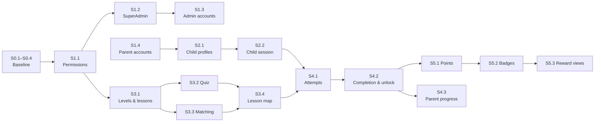

# MVP Implementation Plan

| | |
|---|---|
| **Status** | Draft for review. No step is approved yet. |
| **Last updated** | 2026-10-23 |
| **Related** | [Product decisions](../product/mvp-product-decisions.md) · [Domain model proposal](../../BackEnd/docs/architecture/domain-model-proposal.md) · [Backend status](../../BackEnd/docs/project-status.md) |

## How we work: one step = one review case

1. **Review:** the owner reads the step and answers the open questions that block it.
2. **Plan:** Claude inspects the current code and posts the exact scope, the affected files and the tests.
3. **Approve:** the owner approves or changes the scope.
4. **Build:** Claude implements only that scope. If the model changes, Claude also creates the migration (`dotnet ef migrations add`) and the owner reviews it.
5. **Verify:** build and tests pass. The owner applies migrations in Development with `POST /api/v1/database/migrate`.
6. **Record:** Claude updates the step's status here, `project-status.md` and any affected decision. The owner commits.

Rules for every step:
- Small and reviewable.
- Never drop or recreate the database.
- No new packages without approval.
- Keep the Clean Architecture boundaries.
- Business rules have unit tests. Security and access rules have integration tests.

**Status values:**

| Status | Meaning |
|---|---|
| ✅ Done | Built and verified |
| 🟢 Ready | Can start now |
| 🟡 Needs decision | Waiting for an open question to be answered |
| ⚪ Waiting | Waiting for another step |
| 💤 Later | Not needed for the MVP's first release |

## Overview

| Step | Title | Blocked by | Status |
|---|---|---|---|
| **Phase 0: Baseline** | | | |
| S0.0 | Authentication foundation (login, JWT, refresh rotation, logout, `/me`) | | ✅ Done |
| S0.1 | Commit the current work (owner) | | 🟢 Ready |
| S0.2 | Fix stale lines in `CLAUDE.md` and `overview.md` | | 🟢 Ready |
| S0.3 | Remove test accounts from `EnglishAdventure_Dev` (optional) | owner approval | 🟢 Ready |
| S0.4 | Approve the module structure (ADR-1) and add an architecture test | | ✅ Done 2026-10-23 |
| S0.5 | Replace ASP.NET Core Identity tables with our own tables in `dbo` (ADR-5) | | ✅ Done 2026-10-23 (owner applies the migration) |
| **Phase 1: Identity & Access** | | | |
| S1.1 | Permission catalog and policy-based authorization | (roles decided: PD-008) | 🟢 Ready |
| S1.2 | Secure SuperAdmin bootstrap and role/permission sync | S1.1 | ⚪ Waiting |
| S1.3 | Admin account management | S1.2 | ⚪ Waiting |
| S1.4 | Parent account creation | OQ-010, OQ-008 | 🟡 Needs decision |
| **Phase 2: Family** | | | |
| S2.1 | Child profiles for Parents | OQ-001, OQ-013, S1.4 | 🟡 Needs decision |
| S2.2 | Child session | OQ-009, S2.1 | 🟡 Needs decision |
| **Phase 3: Content** | | | |
| S3.1 | Levels and lessons: manage, order, publish | OQ-005, S1.1 | 🟡 Needs decision |
| S3.2 | Quiz activities | S3.1, OQ-015 | ⚪ Waiting |
| S3.3 | Matching activities | S3.1, OQ-011 | ⚪ Waiting |
| S3.4 | Learner lesson map (read published content) | S3.2, S3.3 | ⚪ Waiting |
| S3.5 | Development seed content | OQ-006, S3.3 | 🟡 Needs decision |
| **Phase 4: Learning** | | | |
| S4.1 | Lesson attempts with server-side grading | OQ-002, OQ-012, S2.2, S3.4 | 🟡 Needs decision |
| S4.2 | Lesson completion and sequential unlocking | OQ-002, OQ-003, OQ-016, S4.1 | 🟡 Needs decision |
| S4.3 | Parent progress view | S4.2 | ⚪ Waiting |
| **Phase 5: Rewards** | | | |
| S5.1 | Points ledger | OQ-004, S4.2 | 🟡 Needs decision |
| S5.2 | Badges | OQ-004, S5.1 | 🟡 Needs decision |
| S5.3 | Rewards views for child and Parent | S5.2 | ⚪ Waiting |
| **Phase 6: Release hardening** | | | |
| S6.1 | Rate limiting on `login` and `refresh` | | ⚪ Waiting |
| S6.2 | Cleanup job for expired refresh tokens | | ⚪ Waiting |
| S6.3 | Fix the vulnerable `System.Security.Cryptography.Pkcs` package | owner approval | 🟢 Ready |
| S6.4 | Privacy: retention, deletion, log review | OQ-008 | 🟡 Needs decision |
| S6.5 | CI pipeline: build and test on every push | | ⚪ Waiting |
| **Later** | | | |
| S7.x | Azure hosting, Key Vault, Application Insights | stable MVP | 💤 Later |
| F.x | Front-end track | OQ-014 | 🟡 Needs decision |

## Suggested order

Admin content does **not** depend on the child-identity decision. So we can build content while OQ-001 is being decided.

1. **S0.1 → S0.4.** Clean baseline and an agreed module structure.
2. **S1.1 → S1.2.** Admins can sign in, and endpoints are protected by permissions.
3. **S3.1 → S3.4.** Admins can build real content. Meanwhile, decide OQ-001 / OQ-009 / OQ-010.
4. **S1.4 → S2.2.** Parents, child profiles, child sessions.
5. **S4.1 → S4.2 → S5.x → S4.3 / S5.3.** The learning loop and rewards.
6. **S1.3, S3.5, Phase 6.** Fit around the above. Phase 6 must be done before any public release.

---

## Step details

### Phase 0: Baseline

**S0.1 Commit the current work (owner).**
- The migrate endpoint, the test database fix and these documents are uncommitted.
- *Done when:* the working tree is clean.

**S0.2 Fix stale documentation.**
- `CLAUDE.md` says the API "does not start yet", calls auth "non-functional" and says user secrets aren't set up. All three are wrong.
- `overview.md` says "no migrations".
- *Done when:* the docs match the code. No code changes.

**S0.3 Remove test accounts from the dev database (optional).**
- Delete the 26 `@example.test` accounts, their refresh tokens and the test-created roles from `EnglishAdventure_Dev`.
- Only with explicit approval; this changes your database.
- *Done when:* `AspNetUsers` contains no `@example.test` rows.
- **Superseded by S0.5:** the `AspNet*` tables and their test accounts no longer exist.

**S0.4 Module structure (ADR-1).** ✅ Done 2026-10-23. The owner approved all 11 decisions (see ADR-1). Added `Domain/Common/Entity.cs`, moved `AccountType` to `Domain/Enums/`, added `DomainArchitectureTests` and `ApplicationArchitectureTests`. No entities, tables or migrations.
- Approve or change the structure in the [domain model proposal](../../BackEnd/docs/architecture/domain-model-proposal.md):
  - The layer trees (§3) and the `Domain/Entities/<Module>` layout (§4).
  - The module rules (§10): one `DbContext`, one table prefix per module, references by ID only.
- If approved, move `Domain/Users/AccountType.cs` to `Domain/Enums/` (a namespace change only; the database is unaffected).
- Add a reflection-based architecture test for the layer rules and the module rules (no new package).
- *Done when:* ADR-1 is marked decided and the test passes.

**S0.5 Own identity tables (ADR-5).** ✅ Done 2026-10-23. All six decisions approved by the owner.
- **Domain entities:** `Account`, `AccountRole`, `Role`, `RolePermission`, `Permission` in `Domain/Entities/Identity`.
- **Database:** tables in `dbo` with the `auth_` prefix (owner's choice). The migration history was reset by the owner: one standalone migration, `InitialCreate`, creates everything. The old `InitialIdentity` migration was deleted.
- **Package:** `Microsoft.AspNetCore.Identity.EntityFrameworkCore` replaced by `Microsoft.Extensions.Identity.Core` (password hashing only).
- **Behavior:** login, refresh, logout and `/me` are unchanged and covered by the existing tests.
- **Owner action:** apply the migration with `POST /api/v1/database/migrate` after restarting the API.

### Phase 1: Identity & Access

**S1.1 Permission catalog and policy authorization.** *Roles decided in PD-008 (OQ-007).*
- **Includes:**
  - Confirm and finalize the permission catalog in [domain model proposal §9](../../BackEnd/docs/architecture/domain-model-proposal.md). This includes the S1.1 points listed in its §12.
  - `Permissions` constants in code.
  - The role-to-permission mapping in code, for exactly the three PD-008 roles.
  - Code checks permissions, never role names.
  - Permission claims in the access token (or looked up per request; decided in this step).
  - A permission policy provider.
  - `[Authorize(Policy = …)]` usage.
  - A 403 ProblemDetails response.
- **Not included:** an admin screen for editing roles.
- **Migration:** none expected (`auth_permissions` and `auth_role_permissions` exist since S0.5).
- *Done when:*
  - A token without the permission gets 403 and a token with it gets 200 (integration tests).
  - Permission names are covered by unit tests.

**S1.2 Secure SuperAdmin bootstrap.**
- **Includes:**
  - A `bootstrap-superadmin` command-line verb.
  - Credentials from environment variables or user secrets only.
  - Refuses to run if a SuperAdmin exists.
  - Creates the roles and syncs their permissions.
  - Validates the password with Identity rules.
- **Not included:** any HTTP endpoint for this.
- *Done when:*
  - The first run creates the SuperAdmin, and a second run refuses.
  - No password appears in code, config files or logs.
  - Tests use a throwaway database.

**S1.3 Admin account management.**
- **Includes:**
  - List accounts (`accounts.read`).
  - Create Admin and Parent accounts; deactivate or reactivate (`accounts.manage`).
  - Assign or remove roles (`roles.manage`).
  - A new Parent account gets the Parent role.
- **Rules:**
  - Nobody can deactivate themselves or change their own roles.
  - The last active SuperAdmin cannot be deactivated or demoted.
  - Deactivating an account revokes its refresh tokens.
  - ContentAdmin can reach none of these endpoints.
- *Done when:* each rule has a test, and an unauthorized call returns 403.

**S1.4 Parent account creation.** *Needs OQ-010 and the relevant parts of OQ-008.*
- Either public self-registration (needs email confirmation, abuse protection and consent) or creation by an Admin (S1.3 already covers that).
- *Done when:* defined after the decision.

### Phase 2: Family

**S2.1 Child profiles.** *Needs OQ-001, OQ-013.*
- **Includes:** a Parent creates, lists, renames and archives their own child profiles (nickname and avatar only).
- **Migration:** `family_child_profiles`.
- *Done when:*
  - A Parent sees only their own profiles.
  - Another Parent's profile ID returns 404 (cross-family test).
  - Validation rules have unit tests.

**S2.2 Child session.** *Needs OQ-009 (proposed: option B).*
- **Includes:**
  - A Parent starts a child session for one profile.
  - The child token carries only `learning.play` and the `child_profile_id`.
  - The child session can be refreshed.
  - Leaving child mode needs the Parent to sign in again.
- **Migration:** a nullable `ChildProfileId` column on `auth_refresh_tokens`.
- *Done when:*
  - A child token cannot call Parent or Admin endpoints.
  - A child token cannot act on another profile.
  - An archived profile cannot start a session.

### Phase 3: Content

**S3.1 Levels and lessons.** *Needs OQ-005.*
- **Includes:**
  - Create, edit and order levels and lessons (as Draft).
  - Publish, unpublish and archive.
  - Optimistic concurrency.
  - The structural-edit rule from OQ-005.
- **Migration:** `content_levels` and `content_lessons`.
- *Done when:* the publishing rules and ordering uniqueness are tested, and only `content.*` permissions can change content.

**S3.2 Quiz activities.** *Needs OQ-015.*
- **Includes:** add, edit and order quiz activities, questions and options.
- **Rules:** at least 2 options and exactly 1 correct option. A lesson can't be published with an invalid activity.
- **Migration:** `content_activities`, `content_quiz_questions`, `content_quiz_options`.
- *Done when:* every invalid configuration returns a clear 400.

**S3.3 Matching activities.** *Needs OQ-011.*
- **Includes:** matching pairs with text or an image URL.
- **Rules:** at least 2 pairs, no duplicate values, exactly one right-hand value per pair.
- **Migration:** `content_matching_pairs`.
- *Done when:* the rules are tested and the activity can be published.

**S3.4 Learner lesson map.**
- **Includes:**
  - A read model of published levels and lessons for learners.
  - Lesson content for play, **without the correct answers**.
  - Lock state is added in S4.2.
- *Done when:* drafts never appear, and the play view contains no answer keys (tested).

**S3.5 Development seed content.** *Needs OQ-006.*
- Seed content is loaded only in Development, by an explicit command or endpoint, never automatically in production.

### Phase 4: Learning

**S4.1 Lesson attempts.** *Needs OQ-002, OQ-012.*
- **Includes:**
  - Start an attempt (checks published and unlocked).
  - Submit answers per activity (see the code flow in domain model proposal §8).
  - Server-side grading.
  - Submitting twice is safe.
- **Migration:** `learning_lesson_attempts` and `learning_attempt_answers`.
- *Done when:*
  - A client-sent score is ignored.
  - Submitting twice returns the same result.
  - A locked lesson cannot be started.
  - The grading rules have unit tests.

**S4.2 Completion and sequential unlocking.** *Needs OQ-002, OQ-003, OQ-016.*
- **Includes:**
  - A first passing attempt creates a `LessonCompletion`.
  - The computed unlock rule.
  - The lesson map shows Locked, Available or Completed.
- **Migration:** `learning_lesson_completions` (unique index on child and lesson).
- *Done when:*
  - The unlock rule is unit-tested, including reordering.
  - Concurrent submits create only one completion (integration test).

**S4.3 Parent progress view.**
- **Includes:** a Parent sees each child's completions, scores and history.
- *Done when:* a cross-family request returns 404 (tested).

### Phase 5: Rewards

**S5.1 Points ledger.** *Needs OQ-004.*
- **Includes:** points awarded on completion inside the same transaction, using the ledger and its unique source key.
- **Migration:** `rewards_points_transactions`.
- *Done when:* retries and concurrent submits never add points twice (tested).

**S5.2 Badges.** *Needs OQ-004.*
- **Includes:** badge definitions (criteria from a fixed set), awarding them, and management of definitions (`rewards.manage`).
- **Migration:** `rewards_badges` and `rewards_badge_awards`.
- *Done when:* each criterion is unit-tested and no badge is awarded twice.

**S5.3 Rewards views.**
- **Includes:** the child sees their points and badges; the Parent sees each child's.
- *Done when:* access rules are tested.

### Phase 6: Release hardening

Every Phase 6 step must be done before any public release.

- **S6.1 Rate limiting:** ASP.NET Core's built-in rate limiter on `login` and `refresh`.
- **S6.2 Refresh-token cleanup:** a background job deletes old expired and revoked rows.
- **S6.3 Vulnerable package:** fix NU1903 for `System.Security.Cryptography.Pkcs` 9.0.11. Needs package approval.
- **S6.4 Privacy:** retention and deletion of child data, log review, decided by OQ-008.
- **S6.5 CI:** build and test on every push, including the SQL integration tests against a throwaway database.

### Later

- **S7.x Azure:** App Service or Container Apps, Azure SQL, Key Vault, Application Insights, and migration bundles in the deploy pipeline.
- **F.x Front end:** starts once OQ-014 is decided. The API contract for each step is ready when that step is Done.

## Change log

| Date | Change |
|---|---|
| 2026-10-23 | First draft. |
| 2026-10-23 | OQ-007 decided (PD-008). S1.1 no longer blocked by a decision; it waits for S0.4. Permission names updated in S1.1, S1.3 and S5.2. |
| 2026-10-23 | S0.4 done (structure approved, recorded as ADR-1). S1.1 is now Ready. |
| 2026-10-23 | S0.5 added and done: own `identity` schema replaces ASP.NET Core Identity tables (ADR-5). S0.3 superseded. |
| 2026-10-23 | S0.5 follow-up: the owner reset the migration history (single `InitialCreate`) and moved the identity tables to `dbo`. |
| 2026-10-23 | Owner decision: no SQL schemas; tables use module prefixes (`auth_`, `family_`, `content_`, `learning_`, `rewards_`). Migration lines in S2–S5 renamed. |
| 2026-10-23 | Aligned with the rewritten domain model proposal: S0.4 scope (layer trees, `Entities` folder, `AccountType` move), section references, per-activity submission (S4.1), unique index instead of composite key (S4.2), `PointsTransactions` (S5.1). |
